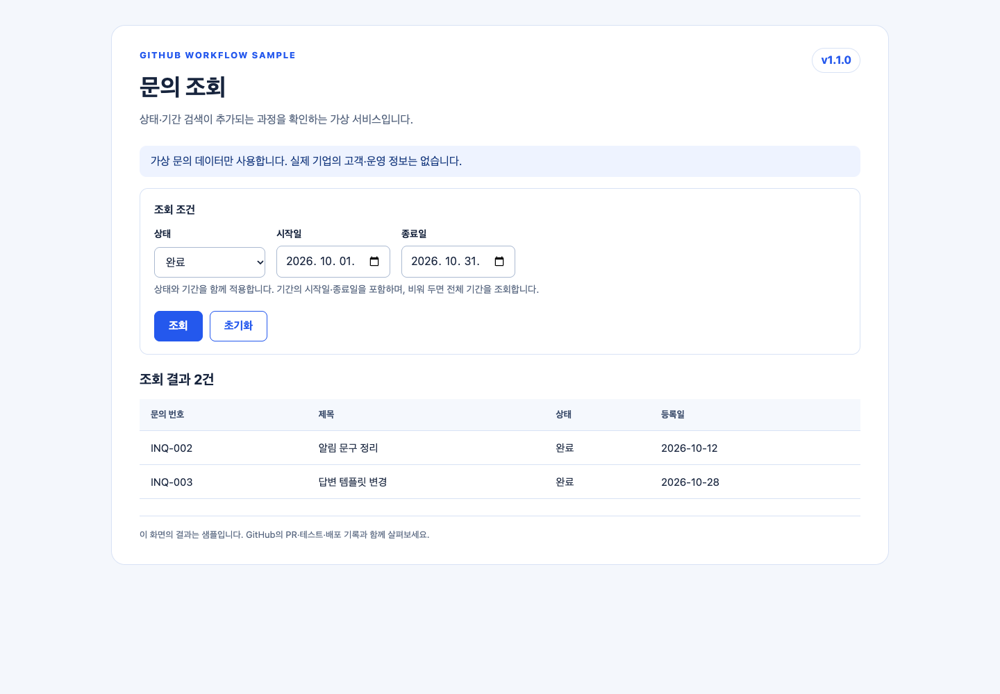

# GitHub Workflow Sample

## 프로젝트 소개

가상 문의 조회 화면을 예로 들어 **요구사항부터 검증·배포까지 이어지는 실제 GitHub 기록**을 살펴보는 샘플 저장소입니다. 코드 변경을 검토받고 반영을 요청하는 PR(Pull Request)을 만들거나 코드를 수정하는 실습 과제는 아닙니다.

브랜치·요구사항·PR·리뷰·댓글·검증·승인·배포·릴리스는 실제 기록입니다. 문의 데이터와 PM·수행사 역할, 업무 판단은 가상이며 실제 기업의 정보가 아닙니다.

## 설치 없이 먼저 보기

아래 공개 화면은 설치 없이 바로 볼 수 있습니다. GitHub 기록도 공개 범위에서 확인할 수 있지만, Actions 실행 보고서와 일부 보안 정보는 로그인이나 열람 권한이 필요할 수 있습니다.

| 먼저 볼 곳 | 여기서 볼 수 있는 내용 |
|---|---|
| [운영 샘플 화면](https://hijigoo.github.io/github-workflow-sample/) | 가상 문의의 상태·기간을 바꿔 보고 검색 결과 확인 |
| [QA(Quality Assurance, 배포 전 품질 확인) 샘플 화면](https://hijigoo.github.io/github-workflow-sample/qa/) | 운영에 게시하기 전에 확인하는 같은 문의 화면 |
| [GitHub 기록 열람 안내](docs/reading-guide.md) | 요구사항, PR 검토, 테스트와 배포 기록을 따라가는 방법 |
| [보안 리포트](docs/security-report.md) | 계정 권한 없이 읽을 수 있는 보안 사례 요약 |

**GitHub 기록을 따라보려면:** [요구사항 #2](https://github.com/hijigoo/github-workflow-sample/issues/2) → [기능 변경 제안(PR) #4](https://github.com/hijigoo/github-workflow-sample/pull/4) → [배포 준비 #5](https://github.com/hijigoo/github-workflow-sample/pull/5) → [main 반영 #6](https://github.com/hijigoo/github-workflow-sample/pull/6) → [최종 릴리스 v1.1.0](https://github.com/hijigoo/github-workflow-sample/releases/tag/v1.1.0)



## 선택 사항: 로컬에서 테스트와 빌드

위 화면과 기록을 보는 데에는 아래 절차가 필요하지 않습니다. 직접 프로젝트를 검증하거나 배포용 파일을 만들어 보고 싶은 경우에만 Node.js 22 이상과 npm을 설치하고, 저장소 루트에서 실행하세요.

```bash
git clone https://github.com/hijigoo/github-workflow-sample.git
cd github-workflow-sample
npm ci --ignore-scripts --no-audit --no-fund --registry=https://packagefeedproxy.microsoft.io/npm/
npx playwright install chrome
npm run typecheck
npm test
npm run build
```

`npm run typecheck`는 타입을 검사하고, `npm test`는 단위 테스트와 브라우저 화면 테스트를 실행합니다. `npm run build`는 정적 화면과 매니페스트를 `dist/`에, 배포 패키지와 증빙을 `artifacts/`와 `reports/`에 생성합니다. 로컬 웹 서버를 시작하는 명령은 없으며, 만든 파일을 확인하는 것이 목적이 아니라면 이 절차를 건너뛰어도 됩니다.

## 네 가지 노트

같은 문의 조회 요청에 상태·기간 검색, 잘못된 기간 안내, 빈 결과 안내를 추가하는 사례입니다.

| 노트 | GitHub 기록 | 연결 방향 |
|---|---|---|
| 기능 추가 노트 | [상태 검색 #3](https://github.com/hijigoo/github-workflow-sample/pull/3), [기간 검색 #4](https://github.com/hijigoo/github-workflow-sample/pull/4) | `feature/status · feature/date → dev` |
| 배포 준비 노트 | [포함 목록·QA·주의사항 #5](https://github.com/hijigoo/github-workflow-sample/pull/5) | `dev → release/v1.1` |
| 릴리스 반영 노트 | [업무 확인·운영 승인·롤백 기준 #6](https://github.com/hijigoo/github-workflow-sample/pull/6) | `release/v1.1 → main` |
| 최종 릴리스 공지 | [v1.1.0 GitHub Release](https://github.com/hijigoo/github-workflow-sample/releases/tag/v1.1.0) | `main`의 태그와 공지·배포 파일 |

체크 상태는 노트 작성 시점의 기록입니다. 당시 남아 있던 QA·운영 승인은 **후속 댓글과 실행 결과**에서 이어 확인합니다.

## 브랜치와 변경 이력

[main](https://github.com/hijigoo/github-workflow-sample/tree/main) · [dev](https://github.com/hijigoo/github-workflow-sample/tree/dev) · [feature/status](https://github.com/hijigoo/github-workflow-sample/tree/feature/status) · [feature/date](https://github.com/hijigoo/github-workflow-sample/tree/feature/date) · [release/v1.1](https://github.com/hijigoo/github-workflow-sample/tree/release/v1.1)

강의와 같은 브랜치 이름을 유지했습니다. [release → dev 역병합 #7](https://github.com/hijigoo/github-workflow-sample/pull/7)과 [보안 조치 브랜치](https://github.com/hijigoo/github-workflow-sample/tree/release/v1.1.1)도 볼 수 있습니다.
병합한 기능·릴리스 브랜치는 삭제하지 않았습니다.

## 검증·승인·배포를 대조하기

| 볼 기록 | 실제 링크 | 읽을 포인트 |
|---|---|---|
| 기능 검증 실패 → 보완 | [기간 변경 실패](https://github.com/hijigoo/github-workflow-sample/actions/runs/41294353825), [보완 후 검증](https://github.com/hijigoo/github-workflow-sample/actions/runs/41294488062) | 정상·예외·기존 조회 결과 |
| 질문과 답변 | [PM 질문·수행사 답변 #4](https://github.com/hijigoo/github-workflow-sample/pull/4#issuecomment-6556348093) | 확인한 것과 남은 작업 |
| 미완성 후보의 취소 | [처음 release 실행](https://github.com/hijigoo/github-workflow-sample/actions/runs/41294211185) | Build 성공이어도 요청 전체가 포함된 것은 아님 |
| 최종 QA | [Build·Test·QA 승인·배포](https://github.com/hijigoo/github-workflow-sample/actions/runs/41295071790) | 실행 커밋·검증 보고서·배포 파일 |
| 운영 샘플 승격 | [운영 승인·동일 파일 배포](https://github.com/hijigoo/github-workflow-sample/actions/runs/41295786524) | QA 파일을 재빌드 없이 게시 |

QA·운영·Release의 `inquiry-app-v1.1.0.tar.gz` SHA-256은 같습니다.

```text
80134ab4381b087eccf420dc82b0eda2951503f570aa7376abd558aba523835b
```

[QA 파일 증빙](https://hijigoo.github.io/github-workflow-sample/qa/release-evidence.json) · [운영 파일 증빙](https://hijigoo.github.io/github-workflow-sample/deployment-evidence.json) · [Release 배포 파일](https://github.com/hijigoo/github-workflow-sample/releases/download/v1.1.0/inquiry-app-v1.1.0.tar.gz)

Actions 보고서는 보존 기한이 있습니다. 최종 배포 파일과 증빙 JSON은 Release에도 첨부했습니다.

## 세 가지 보안 기능

| 기능 | 실제 샘플 | 구분할 것 |
|---|---|---|
| Dependabot | [원본 경고](https://github.com/hijigoo/github-workflow-sample/security/dependabot), [자동 버전 업데이트 PR #1](https://github.com/hijigoo/github-workflow-sample/pull/1) | 의존성 경고, 보안 업데이트, 버전 업데이트는 별개 |
| Code scanning | [SQL 경고 #1](https://github.com/hijigoo/github-workflow-sample/security/code-scanning/1), [조치 PR #8](https://github.com/hijigoo/github-workflow-sample/pull/8), [격리 예시 Dismissed #2](https://github.com/hijigoo/github-workflow-sample/security/code-scanning/2) | GitHub 기능 이름은 Code scanning, 분석 엔진은 CodeQL |
| Secret scanning | [원본 기록 #1](https://github.com/hijigoo/github-workflow-sample/security/secret-scanning/1), [미발급 시험 문자열 증빙](docs/security/evidence/never-issued-token.json) | 실제 Push protection 차단·시험 데이터 예외·종료 기록 |

보안 원본은 로그인 계정과 권한에 따라 열리지 않을 수 있습니다.
권한이 없는 열람자는 [민감 값 없는 공개 보안 리포트](docs/security-report.md)에서 같은 상태·조치·원본 링크를 확인할 수 있습니다.

## 저장소에서 열어 볼 파일

| 위치 | 내용 |
|---|---|
| [web](web) | 실제 공개 문의 화면, 가상 데이터, 상태·기간 조회 |
| [요구사항 기록](docs/requirements/v1.1.0.md) | 요청과 완료 조건 |
| [PR 노트 템플릿](.github/PULL_REQUEST_TEMPLATE) | 네 노트의 작성 구조 |
| [최종 릴리스 문안](docs/release-notes/v1.1.0.md) | 기능·주의사항·포함 변경·Changelog |
| [Actions 정의](.github/workflows) | 검증·CodeQL 분석·QA·운영 승격·샘플 PR 작성 |
| [Dependabot 설정](.github/dependabot.yml) | 버전 확인 일정과 패키지 소스 |
| [코드 분석 격리 예시](src/inquiries/repository.ts) | 공개 사이트와 분리한 CodeQL 관찰용 코드 |

## 실제 자동화와 가상 역할

Build·Test·CodeQL·Pages 배포·Dependabot PR은 실제 실행입니다.
노트 PR 작성자는 **GitHub Actions bot**이며, Copilot cloud agent가 수행한 개발·리뷰 기록으로 표시하지 않습니다.
PM·수행사 댓글은 역할을 설명하는 가상 문안입니다.

PR 리뷰 승인, 외부 작성자 workflow 실행 승인, `qa`·`production` 환경 배포 승인은 서로 다른 기록입니다.
샘플 소유자 계정이 작성한 승인 예이며, 실제 기업의 승인 조직·운영 정책을 대신하지 않습니다.
기업 환경에서는 사용 가능한 기능·권한·실행 위치·데이터 반출 정책을 별도로 확인해야 합니다.

## 안전한 샘플 범위

- 데이터·역할·업무 판단은 가상입니다. 실제 기업의 코드·고객 자료를 사용하지 않습니다.
- 공개 사이트의 Build는 `web/`의 여섯 정적 파일과 매니페스트만 포함합니다.
- `src/inquiries/repository.ts`는 Code scanning 동작을 보여 주는 **비배포 격리 예시**입니다. 실제 서비스 서버를 시작하지 않습니다.
- `lodash@4.17.20`은 Dependabot 경고를 관찰하기 위한 의존성입니다. 공개 화면에서 불러오지 않으며, 안전한 버전의 사용을 권장하는 샘플이 아닙니다.
- 유효한 키·토큰·비밀번호를 저장소에 넣지 않습니다. Secret scanning 시험 문자열은 미발급·사용 불가능한 데이터입니다.
- PR·Issue 번호와 실행 시각은 GitHub가 실제 부여한 값을 사용합니다. 강의의 가상 번호·날짜와 구분합니다.

## 패키지 소스

CI의 npm 명령은 `packagefeedproxy.microsoft.io/npm/`을 사용합니다.
기존 잠금 파일에는 공개 패키지 미러 `ms-feed-25.pkgs.visualstudio.com`의 URL이 기록되어 있으므로,
Dependabot에도 해당 호스트를 명시적으로 등록합니다. 버전·무결성 값·기존 URL은 임의로 바꾸지 않았으며,
레지스트리 인증 키도 추가하지 않았습니다.

이 선언 후에도 npm 보안 업데이트 job에서 미러 호스트 차단이 실제로 발생했습니다.
[실패 실행](https://github.com/hijigoo/github-workflow-sample/actions/runs/41293406345)을 보존하며, 자동 보안 조치가 완료되었다고 표시하지 않습니다.
공개 화면은 해당 의존성을 사용하지 않습니다.

이 문서와 가상 예시는 Copilot을 활용해 작성했습니다. 제품 기능·실행 결과는 연결된 실제 기록과 구분하여 설명합니다.
