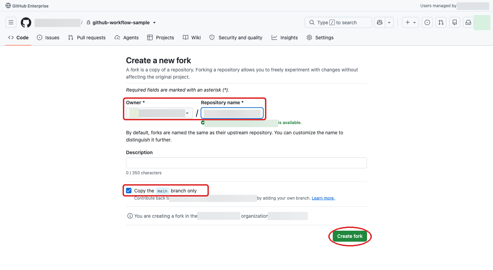
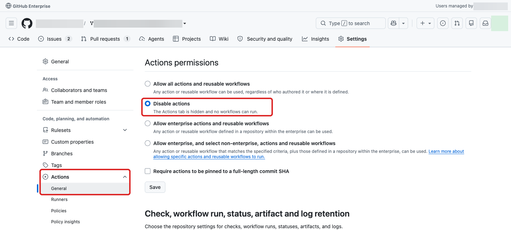

## 00. 실습을 위한 저장소 사전 준비

[전체 목차와 공통 안내](README.md)의 웹 기반·Actions runner 미사용 범위를 따릅니다.
Pioneer가 준비한 기업 내부 기준 저장소를 본인 조직의 실습 저장소로 포크하고 준비 결과를 확인합니다.
저장소 준비가 끝나면 01~04 실습에 사용할 권한과 웹 실행 환경을 확인합니다.
기준 저장소를 만드는 사전 작업은 [Pioneer 가이드](../pioneer-guide.md)를 따릅니다.

## 1. 포크에 필요한 정보와 권한

EMU 계정으로 github.com에 로그인하고 Pioneer 또는 관리자에게 다음을 확인합니다.

* 기업 내부 기준 저장소 링크와 읽기 권한
* 포크가 허용된 기업 내부 조직과 해당 조직에 실습 저장소를 생성할 권한
* 포크의 자동 실행 차단·권한 확인을 지원할 준비 담당자

실습자는 GitHub 웹에서 포크하고 결과를 확인합니다.
이 단계에서는 로컬 도구 설치·GitHub CLI 로그인·터미널 명령을 수행하지 않습니다.

권한이 부족하면 관리자에게 지원을 요청하며 정책을 바꾸거나 우회하지 않습니다.

## 2. 기업 내부 기준 저장소 포크

GHEC EMU에서는 기업 외부 공개 저장소를 직접 포크할 수 없습니다.
[공개 원본 저장소](https://github.com/hijigoo/github-workflow-sample)가 아닌 **기업 내부 기준 저장소** `ORG/github-workflow-sample`을 사용합니다.
`ORG`는 허용된 기업 내부 조직으로, `<USER_ID>`는 본인의 GitHub 사용자 ID로 바꿉니다.

1. 제공된 기준 저장소를 열고 `Fork`를 선택합니다.
2. Owner는 포크가 허용된 본인 기업 내부 조직으로 지정합니다.
   Cloud 구현 실습을 위해 EMU 개인 소유 저장소가 아닌 조직 소유 저장소를 사용합니다.
3. `Repository name`을 `github-workflow-<USER_ID>`로 지정하고 포크를 만듭니다.
   예를 들어 사용자 ID가 `octo`이면 `github-workflow-octo`입니다.
   이번 실습은 `main`만 복사해도 됩니다.
4. 포크한 저장소 주소가 `ORG/github-workflow-<USER_ID>`인지 확인합니다.

`Owner`는 기업 내부 조직, `Repository name`은 본인의 실습 저장소 이름입니다.
이름 아래 사용 가능 안내를 확인한 뒤 `Create fork`를 누릅니다.
버튼을 누른 것만으로 완료로 보지 않고, 이동한 저장소의 이름과 `forked from`에 표시되는 기준 저장소를 확인합니다.

## 3. 실습 저장소 설정 확인

사전 설정된 기준을 바탕으로 본인 포크의 상태만 확인합니다.
Pioneer 또는 위임받은 준비 담당자는
[포크 생성 전 조직 정책과 생성 후 설정](../pioneer-guide.md#포크-생성-전-조직-정책과-생성-후-설정)에 따라
Actions 차단 정책을 사전에 구성하고, 포크 생성 직후 Issues 활성화와 승인된 보안 구성 적용을 담당합니다.
여기서 준비할 상태는 **Issues 켜기, 승인된 Cloud 사용 허용, Actions 끄기**입니다.
본인 포크에서 Code scanning 조회·SARIF 등록까지 진행하려면 비용 승인 후 **Code Security는 켜고 CodeQL default setup은 꺼야** 합니다.
Secret scanning이나 Dependabot를 켜라는 의미가 아닙니다.
실습자는 포크 주소를 준비 담당자에게 전달하고 설정 완료 안내를 받은 뒤 아래 항목을 확인합니다.
기준 저장소의 설정이 포크에 그대로 적용됐다고 가정하지 않으며,
설정이 다르거나 확인할 수 없으면 직접 변경하지 말고 준비 담당자에게 확인을 요청합니다.

> [!IMPORTANT]
> 실제 포크 테스트에서 기준 저장소의 Actions 차단·Issues 활성화·Code Security 설정은 그대로 이어지지 않았습니다.
> 포크 직후에는 **Issue 할당·Cloud 구현·push·PR 생성 전에** 준비 담당자의 설정 확인을 기다립니다.
> 아래 화면은 준비 담당자가 Actions를 비활성화한 **후의 확인 예시**이며, 실습자에게 설정 변경을 지시하는 화면이 아닙니다.

### GitHub 웹에서 준비 결과 확인

* 본인 조직의 실습 저장소 주소를 확인합니다.
* `Settings → General → Features`에서 `Issues` 체크박스가 선택돼 있는지 확인합니다.
  포크의 `Issues → New issue`를 열 수 있어야 합니다.
* `Settings → Actions → General → Actions permissions`에서 `Disable actions`가 적용돼 있는지 확인합니다.
  조직 정책으로 차단한 경우에는 준비 담당자에게 해당 포크가 차단 대상인지 확인받습니다.
  설정을 볼 수 없으면 관리자에게 확인받습니다.
* 조직의 `Copilot in the cloud`가 `Enabled`이고 `Cloud → Repository access`에 본인 포크가 허용돼 있는지 담당자에게 확인받습니다.
  실습 계정의 Copilot Seat와 비용 승인도 필요하며, 실제 세션에서 본인 포크 연결·`Environment → Cloud` 선택이 가능해야 합니다.
* CodeQL default setup·자동 분석·자동 PR 리뷰·에이전트 자동 호출이 꺼져 있는지 확인합니다.
* 포크의 Code scanning 사용이 승인된 경우, 담당자가 `Settings → Advanced Security → Code Security`에서
  `Code Security`(기존 계약은 이를 포함하는 `GitHub Advanced Security`)를 활성화했는지 확인받습니다.
  `CodeQL analysis`의 default setup은 비활성화 상태로 유지합니다. 분석을 시작하는 `Set up`은 누르지 않습니다.
  본인 실습 계정으로 `Security and quality → Code scanning` 메뉴가 열리는지 확인합니다.
  메뉴가 보이지 않거나 404이면 준비 담당자에게 권한과 해당 포크의 Code Security 적용 여부를 확인받습니다.
  경고가 없어도 괜찮습니다. 본인 포크에서 열 수 없으면 04번 기본 실습은 접근 가능한 기준 저장소 경고 또는 SARIF 파일로 진행할 수 있지만,
  본인 포크의 경고 조회·선택 업로드 준비가 완료된 것은 아닙니다. 유료 보안 기능을 임의로 활성화하지 않습니다.

`Disable actions` 선택 상태를 확인합니다. Actions 탭이 보이지 않는 것만으로 판단하지 않습니다.
Issues 탭이 없으면 준비 담당자에게 포크의 Issues 활성화를 요청합니다.

## 4. 실습 권한 확인

본인 EMU 계정으로 다음 권한을 확인하고, 부족한 권한은 준비 담당자에게 요청합니다.

* [ ] 본인 실습 저장소의 코드·문서·Issue·PR을 열람할 수 있습니다.
* [ ] Copilot Seat가 있고, 우측 상단의 Copilot 아이콘을 클릭한 뒤 [New Session](https://github.com/copilot) 메뉴에서 본인 실습 저장소를 연결할 수 있습니다.
* [ ] 본인 실습 저장소에서 Issue·PR을 작성하고 댓글을 남길 수 있습니다.
* [ ] 구현을 위해 작업 브랜치 생성·쓰기·push 권한이 있습니다.
* [ ] 구현·테스트에 사용할 `Cloud` 환경의 사용 권한과 비용 승인을 확인했습니다.
* [ ] 본인 실습 저장소의 Code scanning 열람 가능 여부를 확인했습니다. 불가능하면 04번에서 사용할 기준 저장소 경고 또는 SARIF 파일을 열 수 있습니다.

SARIF 등록 권한은 04번 선택 실습에 참여할 때만 추가로 확인합니다.

실제 토큰·개인정보를 프롬프트에 넣지 않습니다.

## 다음 단계

[01. 프로젝트 이해 (세션 A)](01-project-understanding.md)로 이동합니다.
