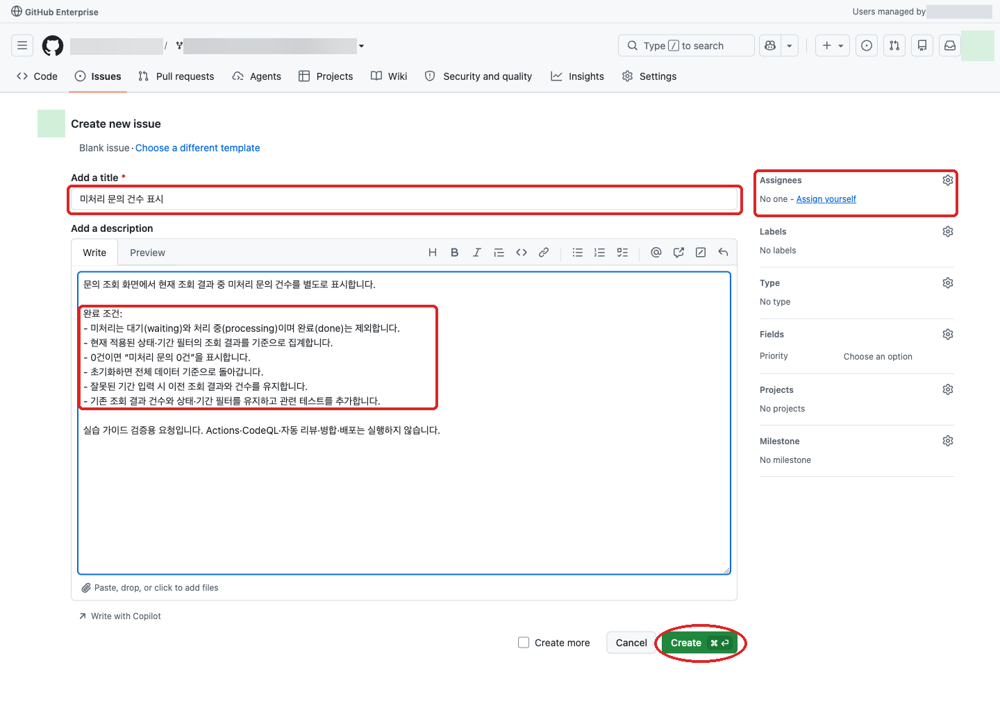
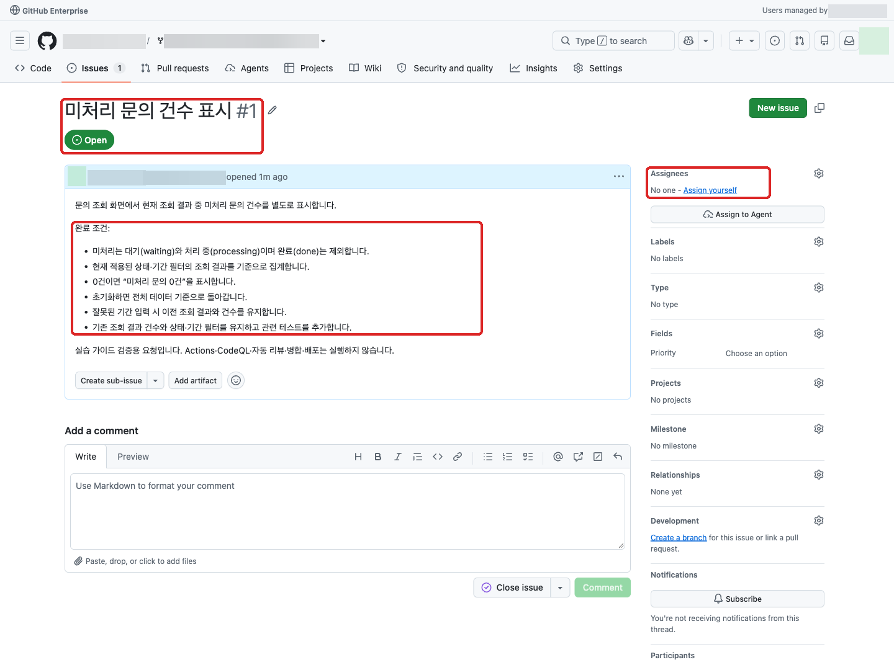
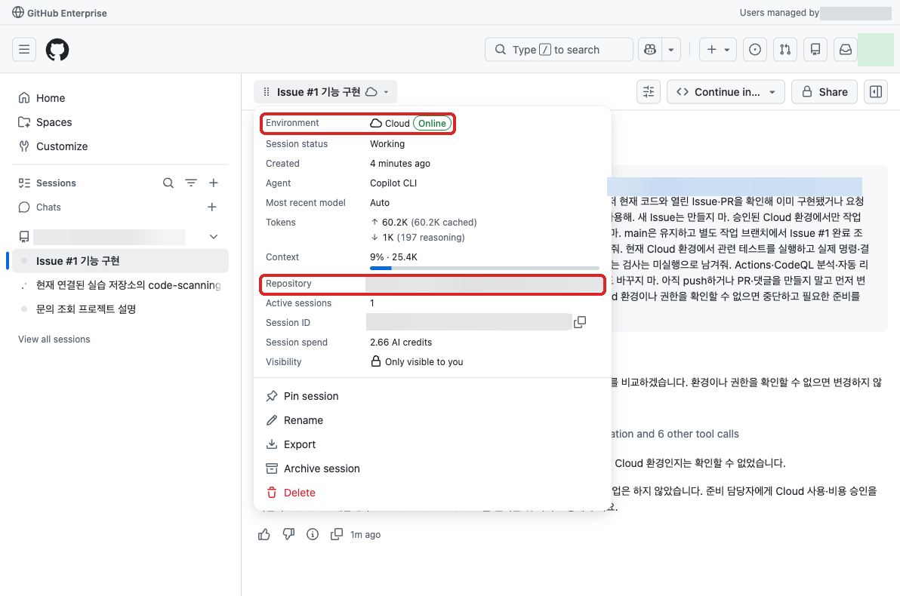
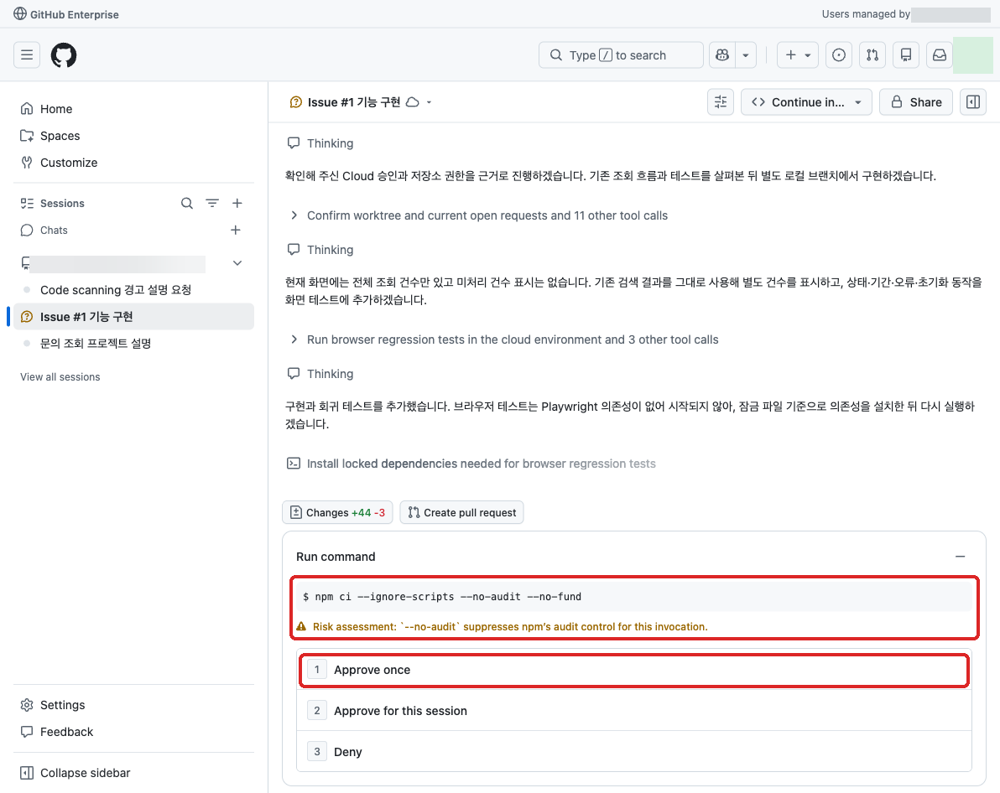
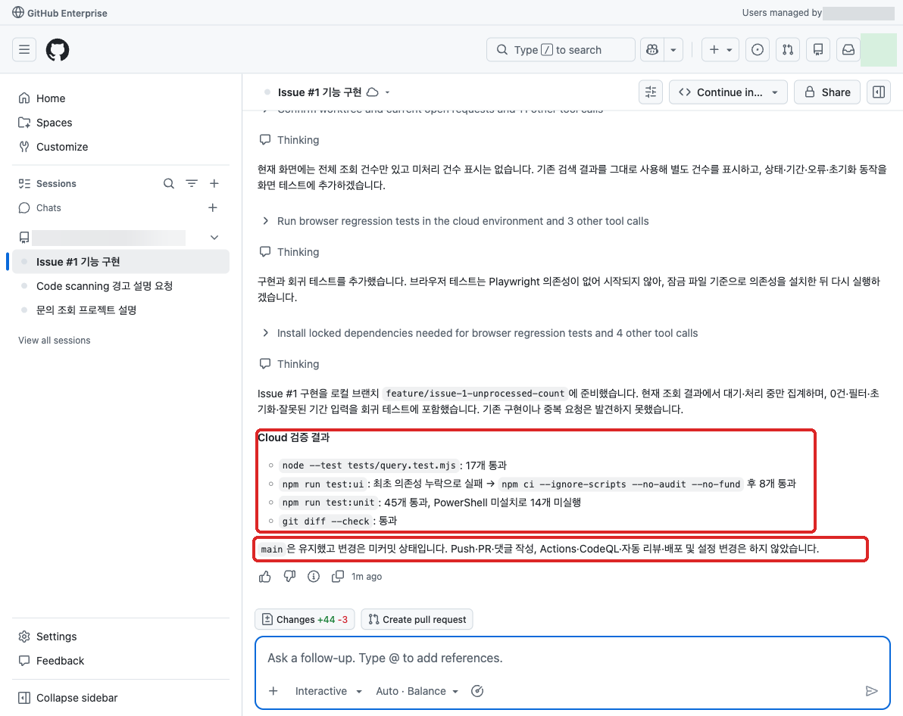

# 02. 새 요구사항 요청 (세션 B)

본 실습에서는 미처리 문의 건수 표시 요구사항을 자연어로 설명하고, 완료 조건을 정리해 Issue를 작성합니다.
승인된 Cloud 환경을 사용할 수 있으면 구현·테스트를 요청하고 결과를 확인한 뒤 PR을 만듭니다.

## 요구사항을 자연어로 설명하기

GitHub 우측 상단의 Copilot 아이콘을 클릭한 뒤 [New Session](https://github.com/copilot) 메뉴를 클릭합니다.
본인의 실습 저장소를 연결하고 자연어로 요청합니다.
슬라이드의 '미처리 상담 건수 표시'를 문의 조회 화면의 '미처리 문의 건수 표시'로 적용합니다.

```text
조직/저장소의 문의 조회 화면에서 미처리 문의가 몇 건인지 바로 보고 싶어.
현재 코드와 열린 Issue·PR을 확인해 이미 구현됐거나 요청된 기능인지 먼저 알려줘.
새 요청이 필요하면 완료된 문의는 제외하고,
상태·기간 필터를 적용했을 때 어떤 범위의 건수를 표시할지 제안해줘.
0건일 때의 안내, 초기화 동작, 기존 조회·오류 처리 유지와 필요한 테스트 기준도 포함해서
업무 담당자가 검토할 수 있는 Issue 초안을 작성해줘.
아직 등록하거나 코드를 수정하지 말고 미정인 조건은 따로 표시해줘.
```

집계 범위와 상태 정의를 확인하고 미정인 조건을 확정합니다.
이미 구현된 기능이면 중복 Issue를 만들지 않고 기존 구현의 검증 근거를 기록합니다.

## Issue 등록

```text
합의한 완료 조건으로 조직/저장소에 Issue를 등록하고 실제 링크를 알려줘.
등록 도구가 없으면 GitHub의 New issue에 붙여 넣을 제목과 본문만 작성해줘.
담당자 할당이나 구현 작업은 아직 시작하지 마.
```

도구가 없으면 GitHub 웹에서 직접 등록합니다. 같은 Issue를 두 번 만들지 않습니다.
실제 Issue 본문과 완료 조건을 확인하며, 이 단계에서는 등록만 하고 Copilot에게 할당하지 않습니다.



직접 등록할 때는 본인 포크의 `Issues → New issue`에서 제목과 본문을 넣고 `Create`를 누릅니다.
Issues 탭이 없으면 포크의 Issues가 비활성화됐을 수 있으므로 준비 담당자에게 요청합니다.



등록 후 주소가 본인 포크의 `/issues/번호`로 바뀌고, 본문과 `No one assigned` 상태가 보이는지 확인합니다.
스크린샷의 #1을 복사하지 말고 본인이 만든 Issue 주소를 다음 요청에 사용합니다.

## Cloud 에이전트에 구현 요청

GitHub 우측 상단의 Copilot 아이콘을 클릭한 뒤 [New Session](https://github.com/copilot) 메뉴를 클릭합니다.
본인의 실습 저장소를 연결하고, 요청을 보내기 전에 `Environment → Cloud`를 선택해 조직이 승인한 실행 환경인지 확인합니다.
Actions 환경만 제공되거나 환경을 확인할 수 없으면 이 단계는 진행하지 않습니다.
구현 대기 사유를 Issue에 남깁니다. 세션 C의 검수는 구현 PR이 생성된 후 이어 진행합니다.

기본 실습에서는 Issue를 Copilot에게 할당하지 않고 승인된 Cloud 세션에서 요청합니다.
Runner 사용이 승인된 경우의 Issue 할당은 아래 선택 실습으로 분리합니다.
Actions 차단은 실습 준비 담당자가 조직 정책으로 설정하고, 실습자는 [00번 사전 점검](00-preparation.md#3-실습-저장소-설정-확인)에서 한 번 확인합니다.
이후 에이전트에게 설정 API 조회를 요청하지 않습니다. Cloud 실행 환경 선택은 별도로 확인합니다.

```text
조직/저장소의 Issue 링크에 합의한 기능을 구현하고 싶어.
승인된 Cloud 환경에서만 작업하고 Actions나 내 PC는 사용하지 마.
main은 유지하고 별도 작업 브랜치에서 완료 조건에 필요한 변경과 테스트를 준비해줘.
현재 Cloud 환경에서 관련 테스트를 실행하고 실제 명령·결과·변경 내용을 알려줘.
실행할 수 없는 검사는 미실행으로 남겨줘.
Actions·CodeQL 분석·자동 리뷰·배포는 실행하지 말고 관련 설정도 바꾸지 마.
Actions 설정 조회도 하지 마.
아직 push하거나 PR을 만들지 말고 먼저 변경 내용과 검증 결과를 보여줘.
Cloud 환경이나 권한을 확인할 수 없으면 중단하고 필요한 준비를 알려줘.
```



환경을 확인할 수 없다는 답변을 받으면 세션 제목 옆 메뉴의 `Session details`에서
`Environment: Cloud`와 `Repository`를 대조하고, 준비 담당자에게 승인 여부를 확인합니다.
셸 환경변수만으로 조직의 비용 승인을 증명할 수는 없습니다.
**실제로 확인한 경우에만** “준비 담당자에게 Cloud 사용·비용 승인을 받았고, 이 세션의 상세 화면에서 Cloud와 대상 저장소를 확인했다”는 사실을 추가로 전달합니다.
확인하지 못했다면 환경 제한을 무시하라고 요청하지 않고 구현 대기로 남깁니다.

Copilot 세션에서 변경 파일과 테스트 실행 기록을 확인합니다.
기존 기능을 중복 구현하거나 요청하지 않은 서버·DB·배포 기능을 추가하지 않았는지 확인합니다.
Cloud 테스트 결과는 GitHub Actions Checks나 CodeQL 분석 성공이 아닙니다.

`Needs attention`이 표시되면 세션에 도구 실행 승인을 기다리는 항목이 있는지 확인합니다.
명령의 대상 저장소·브랜치·작업 범위를 읽고 합의한 작업만 승인합니다.
설정 변경, workflow 실행, push·PR 게시 등 아직 허용하지 않은 명령을 일괄 승인하지 않습니다.
환경 확인에 실패했다는 답변이면 진행 중으로 기다리지 말고 실패 사유를 확인합니다.





이 예시는 UI 테스트의 의존성 누락 후 설치·재실행까지 확인한 결과입니다.
`미실행`·`건너뜀`은 통과가 아닙니다. 실행한 명령과 대상 커밋을 PR에 남기고,
Cloud 답변의 “완료” 표시만으로 모든 OS·검사가 검증됐다고 기록하지 않습니다.

변경을 확인한 뒤에만 다음을 요청합니다.

```text
확인한 변경을 본인 실습 저장소의 작업 브랜치에 커밋하고 PR로 만들어줘.
대상은 조직/저장소이고 base와 head 모두 이 저장소 안에 있어야 해.
main에 직접 커밋하지 말고 main 대상 Draft PR을 하나 만들어줘.
Actions 설정은 조회하거나 변경하지 마.
PR에 연결된 Issue, 변경 내용, Cloud 테스트의 명령·결과·대상 커밋과 미실행 검사를 적어줘.
CodeQL·workflow 실행이나 병합·배포는 하지 말고 실제 PR 링크를 알려줘.
브랜치 push나 PR 작성 권한이 없으면 중단하고 필요한 준비를 알려줘.
```

게시 도구가 없으면 생성했다고 간주하지 않고, 작업 브랜치가 있다면 GitHub 웹에서 PR을 만듭니다.
완료 기준은 검토한 Issue 또는 중복 확인 결과와 구현 PR 또는 구현 대기 사유가 남는 것입니다.
Cloud 사용이 불가능한 경우 구현 PR 생성은 필수 완료 조건이 아닙니다.
생성한 PR은 다음 세션의 검수 대상입니다. 별도 검수용 PR을 만들지 않으며,
포크의 PR 대상이 상위 기준 저장소로 지정되지 않았는지 확인합니다.

PR이 생긴 뒤 `Draft`, base·head, `Assignees`와 리뷰 요청 상태도 확인합니다.
실제 Cloud PR 생성에서는 지시와 별개로 플랫폼이 Copilot을 담당자에 자동 표시했습니다.
이번 실습에서는 본인 PR의 `Assignees`에서 불필요한 Copilot 선택을 해제하고,
`Watch and fix`와 Copilot 리뷰 `Request`는 누르지 않습니다.
본문 작성자나 과거 활동 기록에 Copilot이 보이는 것만으로 현재 자동 작업이 실행 중이라고 판단하지 않습니다.

## 선택 실습

<details>
<summary>Runner 사용이 승인된 경우: Copilot에게 Issue 할당</summary>

Issue 할당형 coding agent는 [GitHub 공식 설명(2025년)](https://github.blog/ai-and-ml/github-copilot/assigning-and-completing-issues-with-coding-agent-in-github-copilot/)에서 GitHub Actions 기반으로 소개됩니다.
이 선택 실습은 Runner 사용이 승인된 경우에만 진행하며, 기본 실습의 Cloud 구현 요청을 대체하는 경로입니다.
같은 Issue를 Cloud 세션과 Issue 할당 양쪽에서 중복 구현하지 않습니다.
할당하면 작업 브랜치와 PR 생성·push가 시작될 수 있으므로, 변경을 확인한 뒤 게시하는 기본 실습과 절차가 다릅니다.

### 시작 전 확인

* 준비 담당자가 기본 실습과 분리된 대상 저장소의 Actions 사용, Runner와 비용을 승인했습니다.
* Copilot Seat, 대상 저장소의 Copilot 사용 허용과 작업 브랜치 쓰기 권한을 확인했습니다.
* 관리자가 대상 저장소의 Actions 정책과 Runner 실행 가능 여부를 확인하고, push·PR 생성으로 실행될 기존 workflow도 점검했습니다.
* CodeQL 새 분석·자동 리뷰·자동 병합·배포는 비활성화 상태로 유지합니다. 기본 실습 저장소의 Actions 차단을 임의로 해제하지 않습니다.

확인하지 못한 항목이 있으면 할당하지 않고 선택 실습을 건너뜁니다.

### Issue 할당과 결과 확인

1. 합의한 완료 조건이 있는 Issue를 열고 우측의 `Assignees`에서 `Copilot`을 선택합니다.
2. 할당 대화상자에서 승인된 대상 저장소와 시작 브랜치를 확인합니다. 상위 기준 저장소를 대상으로 지정하지 않습니다.
3. `Optional prompt`에 다음 지침을 입력하고 할당을 확정합니다.

   ```text
   이 Issue의 완료 조건에 맞춰 승인된 대상 저장소의 별도 작업 브랜치에서 구현해줘.
   main에 직접 커밋하지 말고 필요한 테스트를 승인된 Actions 실행 환경에서 실행해줘.
   CodeQL 새 분석, 다른 workflow의 실행·재실행, 자동 리뷰, 병합·배포는 하지 마.
   Actions나 보안 설정을 변경하지 마.
   PR에 Issue 링크, 변경 내용, 실제 테스트 명령·결과와 미실행 검사를 기록해줘.
   ```

4. 생성된 PR에서 대상 저장소·base·head 브랜치를 확인하고, 연결된 세션 로그에서 변경 파일과 테스트 명령·결과를 확인합니다.
5. PR의 완료 조건 충족 여부를 검수합니다. 실패하거나 미실행된 검사는 그대로 기록하고 병합하지 않습니다.

PR 링크와 검증 결과가 남으면 선택 실습을 마칩니다.
Runner 실행이 실패하면 실패 사유를 기록하고, 동일 작업을 다른 세션에서 중복 시작하지 않습니다.

</details>

## 참고

* [Issue 할당형 coding agent의 Actions 실행 방식 설명(2025년)](https://github.blog/ai-and-ml/github-copilot/assigning-and-completing-issues-with-coding-agent-in-github-copilot/)
* [GitHub 웹에서 Copilot에게 Issue 할당하기](https://docs.github.com/en/copilot/how-tos/use-copilot-agents/cloud-agent/use-cloud-agent-on-github#assigning-an-issue-to-copilot)
* [Cloud 샌드박스와 Actions 실행 환경 구분](https://docs.github.com/en/copilot/concepts/security-governance-and-network-settings/about-cloud-sandboxes)

## 다음 단계

[03. PR 검수와 보완 (세션 C)](03-pr-review.md)으로 이동합니다.
