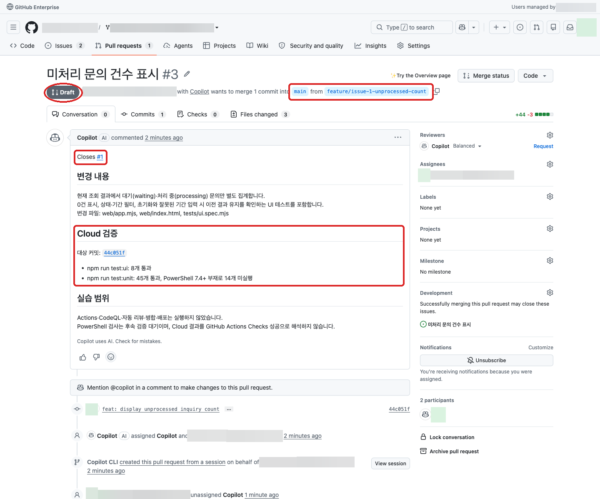
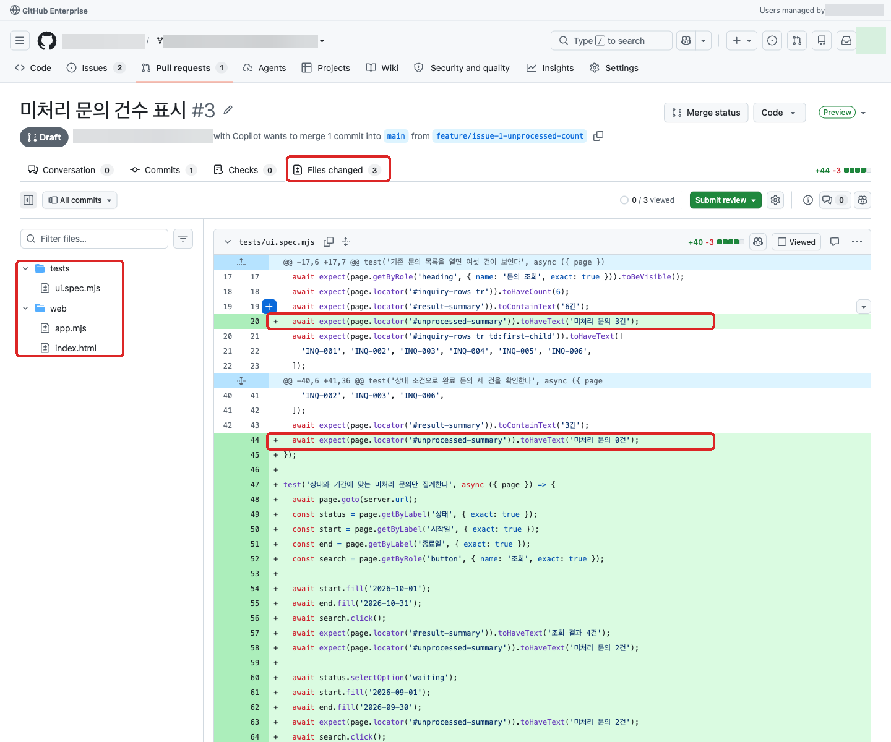
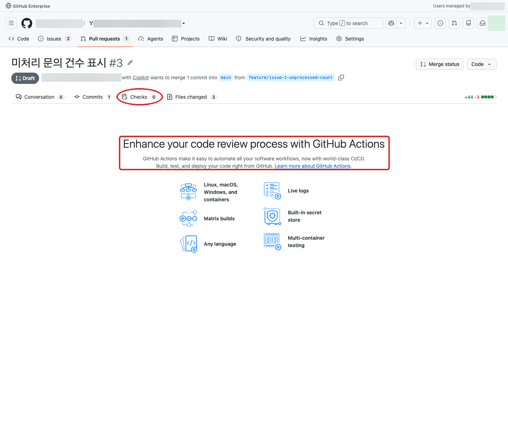
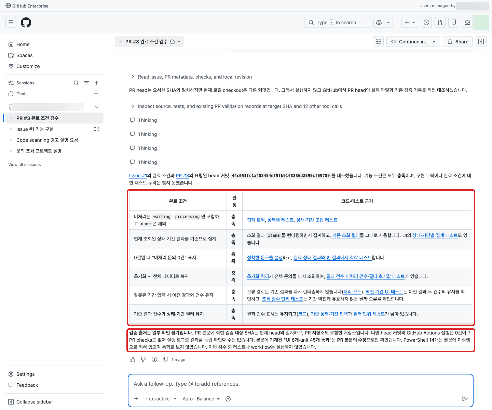
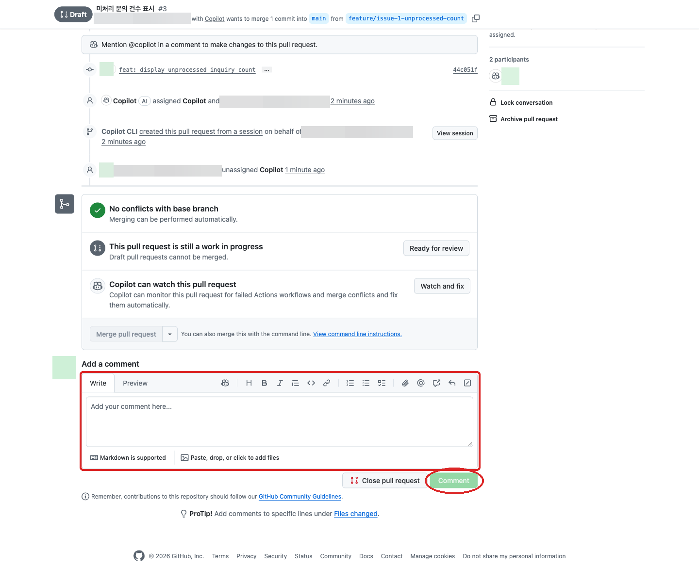

# 03. PR 검수와 보완 (세션 C)

본 실습에서는 이전 실습에서 만든 PR을 Issue의 완료 조건과 비교해 구현·테스트의 누락을 확인합니다.
보완 의견을 댓글로 남기고, 필요한 경우 승인된 Cloud 환경에서 같은 PR의 수정을 요청합니다.

## 이전 단계 실습 결과 확인

시작 전에 [02. 새 요구사항 요청](02-feature-request.md)의 결과를 확인합니다.

* [ ] Issue가 생성됐고, 본문에서 합의한 완료 조건을 확인할 수 있습니다.
* [ ] 해당 Issue를 구현한 PR이 생성됐고, PR 본문과 변경 파일을 열람할 수 있습니다.

두 항목을 모두 확인했으면 아래 PR 검수를 진행합니다.
Issue 또는 구현 PR이 없거나 열람할 수 없으면 이 실습을 진행하지 않고, 02번에서 생성 여부와 권한을 확인합니다.
준비를 기다리는 동안에는 [04. 보안 경고 해석과 조치](04-security.md)를 먼저 진행하고,
Issue와 PR이 준비되면 이 실습으로 돌아옵니다. 별도 검수용 Issue·PR은 만들지 않습니다.



`Conversation`에서 연결된 Issue·테스트 대상 SHA를 확인하고, 상단에서 본인 포크 내부의
`작업 브랜치 → main`인지 확인합니다. `Draft`여도 검수할 수 있으며, 검수하려고 `Ready for review`나 병합 버튼을 누를 필요는 없습니다.

## PR을 자연어로 검수하기

세션 B에서 생성한 미처리 문의 건수 표시 PR을 본인 포크에서 엽니다.
GitHub 우측 상단의 Copilot 아이콘을 클릭한 뒤 [New Session](https://github.com/copilot) 메뉴를 클릭합니다.
본인의 실습 저장소를 연결하고 PR 링크를 지정하여 자연어로 검수를 요청합니다.
자동 PR 리뷰는 요청하지 않습니다.

```text
조직/저장소의 PR 링크를 연결된 Issue의 완료 조건과 비교해줘.
합의한 미처리 상태 정의·집계 범위·0건 안내가 요청대로 구현됐는지 확인하고,
조건별로 충족·미충족·확인 불가를 나눠 코드·테스트의 GitHub 링크를 알려줘.
기간 오류 처리, 초기화, 기존 상태 필터도 유지되는지 봐줘.
기존 코드와 테스트까지 확인해서 구현 누락·테스트 누락·실행 근거 부족을 구분해줘.
검증 자료의 저장소·커밋이 현재 PR과 일치하는지도 확인해줘.
이번에는 기존 자료로 검수만 하고 테스트·workflow·자동 리뷰·코드 변경은 시작하지 마.
```

`Files changed`, `Commits`, PR 본문과 제시된 파일 링크를 브라우저에서 대조합니다.
테스트 코드가 있다는 것만으로 통과했다고 판단하지 않습니다.
Checks가 비어 있어도 실행을 승인하지 않고 미실행으로 기록합니다.
코드 검토에 근거한 예상과 실제 실행 결과를 구분합니다.



왼쪽 파일 목록에서 구현 파일과 테스트 파일을 각각 엽니다.
녹색 추가 행만 읽지 말고 주변의 기존 조회·오류·초기화 동작도 함께 대조합니다.
`Files changed`를 열면 주소가 `/changes`로 표시될 수도 있습니다.
이 단계의 `Submit review`나 Copilot 리뷰 요청은 사용하지 않습니다.



이 실습에서는 Actions를 꺼 두었으므로 `Checks 0`과 빈 안내 화면이 나올 수 있습니다.
Cloud 테스트 결과는 PR 본문의 명령·SHA와 세션의 실행 기록에서 따로 확인합니다.
화면의 Actions 안내를 따라 workflow를 추가하거나 실행하지 않습니다.



새 검수 세션이 PR 본문만 읽었다면 통과 수치는 본문에 적힌 주장으로만 확인한 것입니다.
실제 실행 증빙이 필요하면 구현 세션의 도구 실행 기록에서 명령·결과·대상 커밋을 확인합니다.
검수 세션의 로컬 체크아웃이 `main`이어도 PR head SHA의 파일·diff를 읽어 검수했는지 확인하며,
다른 커밋의 테스트를 현재 PR의 결과로 사용하지 않습니다.

## 같은 PR에 보완 댓글 남기기

실제 누락이 확인된 경우에만 요청합니다.
구현 누락이 없으면 보완 댓글·코드 수정·추가 push는 건너뛰고 조건별 검수 결과와 미확인 사항만 기록합니다.
미실행 검사 때문에 실행 근거가 부족한 경우와 실제 기능 결함을 구분하며, 연습을 위해 결함이나 새 요청을 만들지 않습니다.

```text
확인한 원래 요구사항의 누락을 이 PR에 남길 보완 요청 댓글 초안으로 작성해줘.
재현 절차, 기대 결과, 실제로 관찰한 결과 또는 미확인 사항과 필요한 테스트를 포함해줘.
에이전트 호출 멘션은 넣지 말고, 같은 내용으로 새 Issue를 만들지 마.
댓글 게시·구현·검사 실행은 하지 말고 초안만 보여줘.
```

댓글 초안을 확인한 뒤 복사해 GitHub 웹의 해당 PR `Conversation`에 붙여 넣고 `Comment`를 클릭해 직접 게시합니다.
게시된 댓글 내용과 링크를 확인합니다.
댓글 게시 성공은 보완 완료가 아닙니다.
새 `@copilot` 댓글이나 기존 댓글 편집으로 작업을 호출하지 않습니다.



이 이미지는 댓글 **입력 전** 화면입니다. 실제 보완 의견이 있을 때만 검토한 문안을 붙여 넣고
`Preview`에서 확인한 뒤 `Comment`로 게시합니다. `Close pull request`, `Watch and fix`, 에이전트 호출 멘션과 혼동하지 않습니다.

## 같은 PR의 보완을 Cloud 에이전트에 요청하기

누락이 있고 승인된 **Cloud** 환경을 사용할 수 있을 때만 진행합니다.
[New Session](https://github.com/copilot)에서 새 세션을 열었다면 실행 환경·저장소·PR head 브랜치를 다시 확인합니다.

```text
조직/저장소의 PR 링크에서 확인한 보완 댓글 링크의 누락만 수정해줘.
승인된 Cloud 환경에서 이 PR의 head 브랜치를 사용하고 main은 변경하지 마.
기존 작업을 덮어쓰거나 별도 PR을 중복 생성하지 마.
필요한 회귀 테스트를 추가하고 Cloud에서 실행한 명령·결과·수정 내용을 먼저 보여줘.
아직 push하지 말고 Actions·CodeQL·자동 리뷰·배포는 실행하지 마.
실행 환경이나 브랜치를 확인할 수 없으면 중단해줘.
```

수정 내용을 확인한 뒤 후속 요청을 합니다.

```text
확인한 수정만 같은 PR의 head 브랜치에 커밋해서 반영해줘.
저장소 Actions가 비활성화돼 있는지 먼저 확인하고 확인할 수 없으면 push하지 마.
수정 커밋과 Cloud 테스트 결과를 PR에 기록하고,
새 커밋에 이전 커밋의 검사 결과를 그대로 적용하지 마.
workflow 실행·새 PR 생성·병합·배포는 하지 마.
```

같은 PR의 diff·커밋·테스트 기록을 웹에서 다시 확인합니다.
Cloud를 사용할 수 없으면 보완 댓글과 검증 대기 사유·후속 담당자를 남깁니다.
설정 API 권한 부족으로 게시가 중단되면 [02번의 관리자 수동 확인 경로](02-feature-request.md#actions-설정-조회가-403으로-중단된-경우)를 확인합니다.
이전 PR 생성 시의 확인을 재사용하지 않고, 새 push 직전의 대상 포크 설정을 다시 확인받습니다.
원래 요구사항의 보완은 같은 PR에서 처리하고 새 요구사항만 별도 Issue로 분리합니다.
완료 기준은 조건별 판정과 근거, 보완 결과 또는 대기 상태가 남는 것입니다.

## 참고

### PR 검수와 댓글

* [PR의 커밋·변경 파일·diff 검토](https://docs.github.com/en/pull-requests/how-tos/review-pull-requests/reviewing-proposed-changes-in-a-pull-request)
* [GitHub 웹에서 PR의 Conversation에 댓글 남기기](https://docs.github.com/en/pull-requests/how-tos/review-pull-requests/commenting-on-a-pull-request)
* [PR과 Issue의 연결 확인](https://docs.github.com/en/issues/tracking-your-work-with-issues/using-issues/linking-a-pull-request-to-an-issue)

### Cloud 세션과 검증 근거

* [Copilot 세션 시작 시 저장소·브랜치·실행 환경 선택](https://docs.github.com/en/copilot/how-tos/use-copilot-agents/cloud-agent/use-cloud-agent-on-github)
* [Cloud 샌드박스와 Actions 실행 환경 구분](https://docs.github.com/en/copilot/concepts/security-governance-and-network-settings/about-cloud-sandboxes)
* [Copilot 세션 로그 확인과 후속 요청](https://docs.github.com/en/copilot/how-tos/copilot-on-github/use-copilot-agents/manage-and-track-agents)

## 다음 단계

[04. 보안 경고 해석과 조치 (세션 D)](04-security.md)로 이동합니다.
