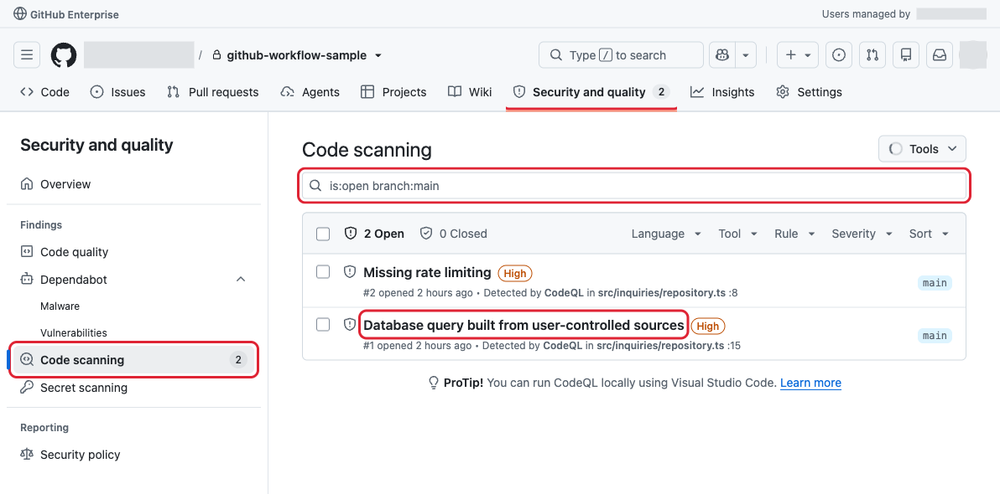
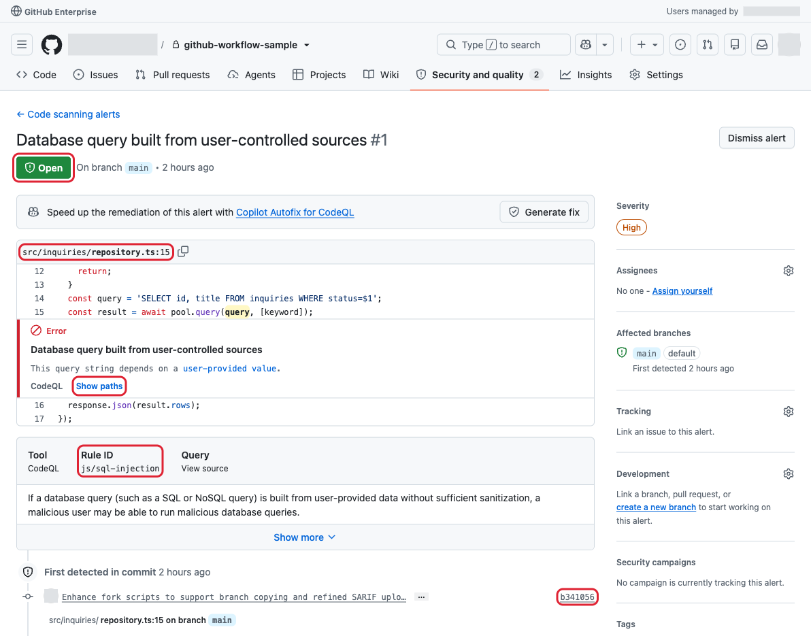
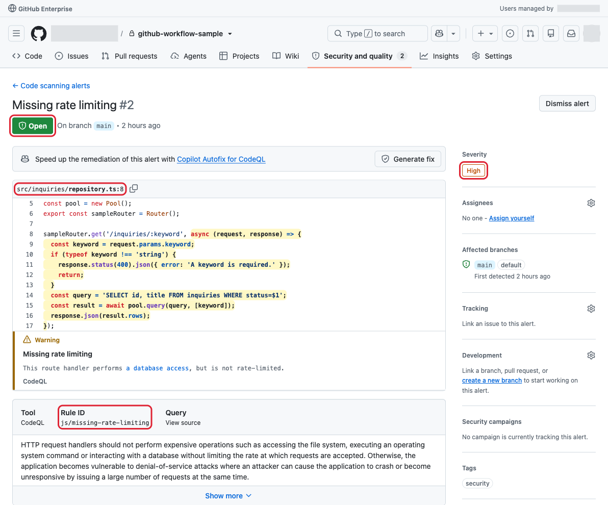
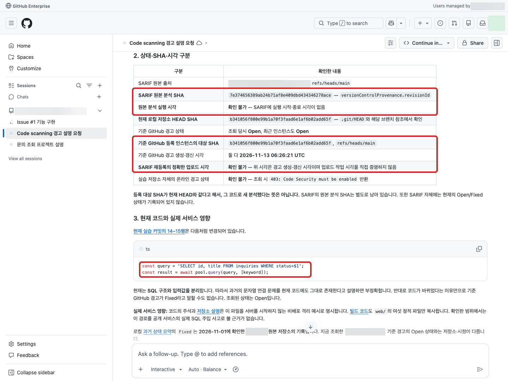
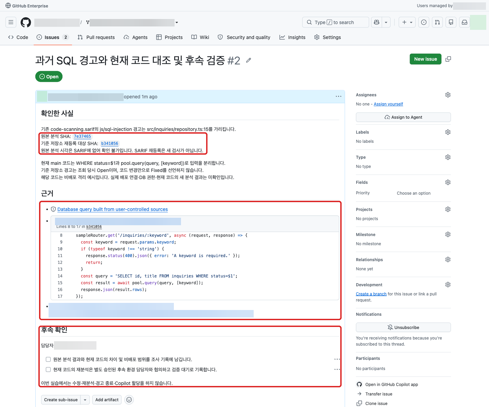

# 04. 보안 경고 해석과 조치 (세션 D)

본 실습에서는 기존 CodeQL 경고 또는 SARIF를 웹에서 읽고, 자연어로 보안 이슈의 의미와 영향·조치 방향을 확인합니다.
조사·조치 Issue를 작성하며, 필요한 경우에만 승인된 Cloud 환경에서 수정을 요청합니다.

## SARIF란

SARIF(Static Analysis Results Interchange Format)는 CodeQL 같은 정적 분석 도구의 결과를 담는 JSON 기반 표준 파일 형식입니다.
경고 종류, 설명과 문제가 발견된 파일·코드 위치 등이 포함됩니다.
GitHub에 업로드하면 기존 결과를 Code scanning 화면에서 조회·분석할 수 있으며, 업로드 자체가 새로운 보안 검사를 실행하는 것은 아닙니다.

<details>
<summary>추가 설명: CodeQL이란</summary>

CodeQL은 소스 코드를 분석해 SQL injection 같은 보안 문제를 찾는 정적 분석 엔진입니다.
CodeQL이 분석을 수행하고, SARIF는 그 결과를 담으며, GitHub의 Code scanning은 결과를 조회·관리하는 기능입니다.

이 저장소의 [CodeQL workflow](../../.github/workflows/codeql.yml)는 분석 실행과 결과 등록을 담당합니다.
[분석 설정](../../.github/codeql/config.yml)은 `web`·`src`를 대상으로 `security-extended` 쿼리를 사용합니다.
본 실습에서는 기존 분석 결과만 해석하며, 이 workflow를 실행하거나 새 분석을 요청하지 않습니다.

</details>

## 웹에서 기존 경고 해석하기

`Security and quality → Code scanning`에서 경고를 보려면 해당 저장소에 SARIF 등 분석 결과가 등록돼 있어야 합니다.

* 기준 저장소에는 준비 과정에서 SARIF가 등록됩니다. 경고 목록·상세 조회에는 기본 역할 기준 **Write(쓰기) 이상** 권한이 필요하며, 코드 Read(읽기) 권한만으로는 볼 수 없습니다.
  기준 저장소에 해당 권한이 있으면 **기준 저장소의 `Security and quality → Code scanning` 메뉴**에서 등록된 결과를 직접 확인할 수 있습니다.
* 포크에는 코드와 커밋된 SARIF 파일만 복사되고 **원본의 경고·상태는 복제되지 않습니다.** 본인 포크의 Code scanning에서 보려면 해당 포크에 별도로 SARIF를 등록하고 열람 권한을 갖춰야 합니다.
* 경고 조회 권한이 없으면 커밋된 [SARIF 파일](../../code-scanning.sarif)을 GitHub 웹에서 열어 해석합니다.

### 1. 업로드한 결과가 표시되는 메뉴 열기

SARIF 등록이 완료된 **대상 저장소**를 열고, 상단의 **Security and quality**를 클릭한 뒤
왼쪽 **Code scanning**을 선택합니다. SARIF 파일의 Code 화면이나 Actions 실행 목록이 아니라 이 메뉴에서 경고를 확인합니다.
이름이 `Security`로 표시되는 환경에서도 Code scanning 메뉴를 찾습니다.



이후 세 화면은 **기업 내부 기준 저장소에 기존 SARIF를 등록한 예시**이며 실습자 포크의 결과가 아닙니다.
상단 메뉴와 왼쪽 탐색 영역을 남겨 위치를 표시했고, 빨간 테두리가 확인할 부분입니다.
조직명·사용자 식별 정보는 가렸습니다. 본인 업로드를 확인할 때는 반드시 본인 대상 저장소에서 진행합니다.

검색창의 `is:open branch:main`은 **main 브랜치의 열린 경고만** 표시합니다.
화면의 `2 Open`과 각 경고의 제목·`High`·파일·라인·브랜치를 확인합니다.
SARIF에 포함된 경고와 이 화면의 대응 관계는 다음과 같습니다.

| 목록의 경고 제목 | 상세 화면의 Rule ID | 등록된 위치 |
|---|---|---|
| Database query built from user-controlled sources | `js/sql-injection` | `src/inquiries/repository.ts:15` |
| Missing rate limiting | `js/missing-rate-limiting` | `src/inquiries/repository.ts:8` |

`2 Open`은 이 캡처 시점의 예시 값이며, 모든 저장소에서 두 건이 열린 상태로 보여야 한다는 뜻은 아닙니다.
닫힌 경고는 `Closed`에서 확인하고, 대상 브랜치가 다르면 검색창의 `branch:main`을 해당 브랜치로 바꿉니다.
필터 변경은 조회 조건만 바꾸며 경고를 종료하거나 새 분석을 실행하지 않습니다.

### 2. SQL injection 경고 상세 확인

목록의 **Database query built from user-controlled sources** 제목을 클릭합니다.



상단의 `Open`·`On branch main`, 코드 위의 `src/inquiries/repository.ts:15`,
코드 아래의 `Rule ID: js/sql-injection`을 확인합니다. 오른쪽에는 심각도 `High`가 표시됩니다.
`Show paths`를 누르면 SARIF에 포함된 입력부터 문제 지점까지의 전달 경로를 읽을 수 있습니다.

하단 `First detected in commit`은 경고가 처음 기록된 커밋을 보여줍니다.
기존 SARIF를 재등록한 경우 이 표시만으로 현재 코드를 새로 분석했다고 판단하지 않습니다.

이 경고는 사용자 입력으로 구성된 데이터베이스 쿼리의 위험을 설명합니다.
다만 캡처의 코드는 `pool.query(query, [keyword])` 형태이므로,
화면에 경고가 있다는 이유만으로 현재 코드의 SQL injection 취약성이 확정됐다고 판단하지 않습니다.
아래 과거 분석 결과와 현재 코드의 구분 안내를 함께 확인합니다.

### 3. Rate limiting 경고 상세 확인

상세 화면 왼쪽 위의 **← Code scanning alerts**로 돌아가 **Missing rate limiting** 제목을 클릭합니다.



`src/inquiries/repository.ts:8`과 `Rule ID: js/missing-rate-limiting`을 확인합니다.
이 경고는 데이터베이스 접근 같은 비용이 큰 작업을 수행하는 HTTP 처리기에 요청 빈도 제한이 없으면
대량 요청으로 서비스가 느려지거나 응답하지 않을 수 있다는 의미입니다.
실제 영향은 해당 경로의 노출 여부와 프록시·게이트웨이 등 다른 계층의 제한도 조사한 뒤 판단합니다.

두 상세 화면의 `Generate fix`·`Dismiss alert`는 이 해석 단계에서 누르지 않습니다.
경고 조회와 보안 수정 요청·경고 종료는 서로 다른 작업입니다.

### 4. 과거 분석 결과와 현재 코드를 구분해 해석

> [!IMPORTANT]
> 이 SARIF는 과거 코드의 분석 결과입니다.
> 업로드는 새 보안 검사가 아니므로, 현재 코드의 취약성이나 수정 완료 여부를 확정할 수 없습니다.

<details>
<summary>참고: SARIF의 분석 커밋과 시각</summary>

커밋된 SARIF의 `versionControlProvenance.revisionId`는
`7e374656389ab24b71af8e409dbd434346278ace`입니다.
이 파일에는 분석 실행 시각(`invocations`의 시작·종료 시각)이 없어 파일만으로는 분석 시각을 확인할 수 없습니다.
GitHub에 재등록한 대상 커밋·등록 시각, 현재 코드의 커밋은 원본 분석 정보와 다를 수 있습니다.
예시 화면에서도 SQL 경고는 Open이지만 연결된 코드에는 매개변수화 쿼리가 보입니다.
이 차이를 새 탐지나 수정 실패의 증거로 단정하지 않고, 재분석 전까지 해소 여부는 미확인으로 남깁니다.



</details>

원본의 경고 번호·Fixed·Dismissed 상태·종료 사유는 포크에 복제되지 않습니다.
경고가 보이지 않으면 대상 저장소·브랜치·`Open`/`Closed` 필터, 분석 등록 내역·처리 상태·권한을 확인합니다.
메뉴가 없거나 404가 표시되면 대상 조직에 접근 가능한 계정·조직 SSO와 Code scanning 열람 권한을 확인합니다.
이유를 확인할 수 없으면 설정을 임의 변경하거나 재업로드하지 말고 커밋된 [SARIF](../../code-scanning.sarif)를 사용합니다.
빈 목록만 보고 업로드 성공이나 전체 안전을 단정하지 않습니다.

GitHub 우측 상단의 Copilot 아이콘을 클릭한 뒤 [New Session](https://github.com/copilot) 메뉴를 클릭합니다.
본인의 실습 저장소를 연결하고 경고 또는 SARIF 파일 링크를 붙여 자연어로 요청합니다.
직접 조회 도구가 없으면 화면의 비민감 경고 설명을 제공합니다.
자료의 출처가 기준 저장소인지 본인 포크인지, 파일 기반 해석인지 구분합니다.
현재 결과는 과거 코드의 분석 결과이며 새로 수행한 보안 검사가 아닙니다.

```text
현재 연결된 실습 저장소의 code-scanning.sarif를 읽고, 경고 내용을 업무 담당자가 이해할 수 있게 설명해줘.
제공한 Code scanning 경고 링크가 있으면 함께 참고해줘.
js/sql-injection 또는 js/missing-rate-limiting 중 실제 경고 한 건을 기준으로,
어떤 입력이 어떤 코드로 전달돼 문제가 될 수 있는지 근거 링크와 함께 알려줘.
탐지 사실, 실제 서비스 영향, 확인하지 못한 사항과 권장 조치를 구분해줘.
규칙·파일·라인을 확인하고, 경고 상태는 제공된 자료에서 확인되는 경우에만 알려줘.
현재 코드와 과거 결과가 다르면 설명하고, 확인하지 못한 사항은 확인 불가라고 해줘.
직접 조회하지 못하면 그 사실을 알려주고 제공된 경고 내용이나 code-scanning.sarif에만 근거해줘.
새 분석·코드 수정·경고 종료는 하지 마.
```

답변을 경고 원문과 코드 링크에 대조합니다.
슬라이드의 `js/path-injection`은 가상 예시이며 이 저장소의 실제 경고가 아닙니다.
기존 보안 리포트나 다른 저장소의 기록을 본인 저장소의 현재 결과로 해석하지 않습니다.
Open은 악용 가능성 확정이 아니며, Fixed와 Dismissed도 같은 의미가 아닙니다.
교육용 격리 코드라는 이유만으로 오탐 처리하지 않습니다.

## 조사·조치 Issue 작성

```text
현재 연결된 실습 저장소의 code-scanning.sarif에서 확인한 경고 한 건을 조사·조치하는 Issue 초안을 작성해줘.
탐지된 사실, 영향 판단, 확인하지 못한 사항과 근거가 되는 경고 또는 파일 링크를 구분해줘.
수정 필요성을 판단할 조사 항목과, 수정한다면 필요한 변경·테스트 범위를 적어줘.
code-scanning.sarif에서 확인되는 분석 SHA와 시각을 기록하고, SARIF 업로드는 새 검사가 아님을 명시해줘.
원본 분석 SHA와 재등록 대상 SHA를 구분하고 파일에 없는 분석 시각·현재 경고 상태는 확인 불가로 남겨줘.
CodeQL 재분석은 이번 실습에서 실행하지 않으므로 후속 확인 항목으로 남겨줘.
기존 Issue·PR과 중복되지 않게 하고 아직 등록하거나 구현하지 마.
```

초안을 경고 원문과 대조한 뒤 요청합니다.

```text
검토한 조사·조치 Issue를 조직/저장소에 등록하고 링크를 알려줘.
등록 도구가 없으면 GitHub에 직접 제출할 제목과 본문만 작성해줘.
Copilot 담당자 할당이나 경고 상태 변경, 수정 작업은 시작하지 마.
```

도구가 없으면 GitHub 웹에서 직접 등록합니다.
조사만 필요한 상황에서 구현이나 PR 생성을 억지로 요청하지 않습니다.



등록된 본문에 실제 근거 링크와 후속 담당자, `검증 대기`가 남았는지 확인합니다.
이 예시는 조사 Issue이며 보안 수정 PR이나 경고 해소 결과가 아닙니다.

## 수정이 필요한 경우의 후속 요청

수정 필요성을 확인했고 Copilot 세션에서 승인된 **Cloud** 환경을 사용할 수 있을 때만 진행합니다.
사용할 수 없으면 Issue에 구현 대기와 후속 담당자를 기록합니다.

```text
조직/저장소의 조사·조치 Issue 링크에서 합의한 수정만 준비해줘.
승인된 Cloud 환경에서 수정과 회귀 테스트를 수행해줘.
현재 연결된 실습 저장소의 code-scanning.sarif를 참고하고 이 파일은 수정하지 마.
Actions·CodeQL 분석·자동 리뷰는 실행하지 마.
경고를 Fixed나 Dismissed로 처리하지 마.
아직 push나 PR 생성은 하지 말고 변경 내용과 실제 Cloud 테스트 결과,
CodeQL 재분석 등 아직 확인하지 못한 사항을 알려줘.
환경이나 권한을 확인할 수 없으면 중단해줘.
```

수정 결과를 PR로 남기려면
[02. 새 요구사항 요청 (세션 B)](02-feature-request.md)의 PR 생성 절차를 따릅니다.
코드 수정이나 Cloud 회귀 테스트, 기존 SARIF 재등록만으로 경고 해소를 선언하지 않습니다.
CodeQL 재분석과 Fixed 전환 확인은 승인된 후속 환경의 담당자에게 남깁니다.
Dependabot·Secret scanning은 이번 CodeQL SARIF의 대상이 아닙니다.

완료 기준은 경고 또는 웹 자료에 근거한 조사·조치 Issue와 후속 담당자 지정입니다.
수정 결과가 있어도 재분석 전에는 보안 검증 대기로 기록합니다.

## 선택 실습: 기존 SARIF 등록

기본 웹 실습을 마친 뒤, 관심 있는 실습자만 함께 복사된 SARIF를 본인 실습 저장소에 등록해 봅니다.
이 단계는 필수가 아니며 건너뛰어도 기본 실습을 완료할 수 있습니다. Actions runner나 새 CodeQL 분석은 사용하지 않습니다.

<details>
<summary>로컬 명령으로 SARIF 등록해 보기</summary>

### 실행 전 확인

* [실습 준비 담당자 가이드의 준비 도구와 CLI 인증](../pioneer-guide.md)을 참고해 Git·GitHub CLI와 OS별 도구를 준비합니다.
* EMU 계정으로 GitHub CLI에 로그인하고 본인 포크에 SARIF를 등록할 권한을 확인합니다.
* 관리자에게 포크의 Code Security 이용 권한·비용 승인을 확인받습니다. 이 명령은 Code Security를 활성화하지 않습니다.
* 포크의 Actions·CodeQL default setup이 비활성화돼 있고 자동 실행이 차단돼 있는지 확인합니다.
* 같은 결과가 이미 등록돼 있다면 중복 제출하지 않고 웹 결과만 확인합니다.

아래 `ORG`와 `<USER_ID>`를 본인의 실제 대상 조직·GitHub 사용자 ID로 바꿉니다.
따옴표는 유지하고 `<USER_ID>`의 꺾쇠까지 바꿉니다.
`--confirm-settings` 또는 `-ConfirmSettings`는 위 정책·권한·비용을 확인한 뒤에만 지정합니다.

macOS·Linux:

```bash
bash ./scripts/linux/fork.sh \
  --target 'ORG/github-workflow-<USER_ID>' \
  --sarif ./code-scanning.sarif \
  --upload-only \
  --confirm-settings
```

Windows:

```powershell
pwsh -NoProfile -File .\scripts\win\fork.ps1 `
  -TargetRepo 'ORG/github-workflow-<USER_ID>' `
  -SarifFile ./code-scanning.sarif `
  -UploadOnly `
  -ConfirmSettings
```

### 등록 결과 확인

업로드 전용 모드는 저장소 생성·설정 변경·Git push를 하지 않으며 로컬 대상 디렉터리 지정도 필요하지 않습니다.
실행 출력의 `SARIF processing complete:`를 확인한 뒤,
본인 포크의 `Security and quality → Code scanning`을 엽니다.
[업로드한 결과가 표시되는 메뉴 열기](#1-업로드한-결과가-표시되는-메뉴-열기)의 캡처 순서대로
대상 저장소·브랜치·필터를 확인하고, 경고 제목을 눌러 규칙·파일·라인·등록 대상 커밋을 대조합니다.
API 접수만으로 등록 완료를 판단하지 않습니다.

실패하면 출력된 오류와 업로드 ID의 처리 상태를 확인하고, 확인 없이 중복 제출하지 않습니다.
권한·도구·설정이 준비되지 않았다면 명령 실행을 건너뛰고 기본 웹 실습 결과를 사용합니다.
Actions workflow로 대신 등록하거나, 기존 SARIF 등록을 새 검사·경고 해소로 기록하지 않습니다.
Dependabot·Secret scanning은 이 SARIF의 등록 대상이 아닙니다.

</details>

## 참고

### CodeQL과 SARIF

* [CodeQL의 역할과 분석 결과](https://docs.github.com/en/code-security/concepts/code-scanning/codeql/codeql-code-scanning)
* [SARIF 파일의 형식과 GitHub에서의 활용](https://docs.github.com/en/code-security/concepts/code-scanning/sarif-files)

### 이 실습의 경고 규칙

* [SQL injection 경고의 원인과 권장 조치](https://codeql.github.com/codeql-query-help/javascript/js-sql-injection/)
* [Rate limiting 누락 경고의 원인과 권장 조치](https://codeql.github.com/codeql-query-help/javascript/js-missing-rate-limiting/)

### 경고 조회와 선택 등록 실습

* [Code scanning 경고 조회·평가](https://docs.github.com/en/code-security/how-tos/manage-security-alerts/manage-code-scanning-alerts/assess-alerts)
* [기존 SARIF 파일 업로드](https://docs.github.com/en/code-security/how-tos/find-and-fix-code-vulnerabilities/integrate-with-existing-tools/upload-sarif-file)

## 실습 마무리

조사·조치 Issue에 결과와 후속 담당자를 남기고 [전체 실습 목차](README.md#실습-순서)로 돌아갑니다.
