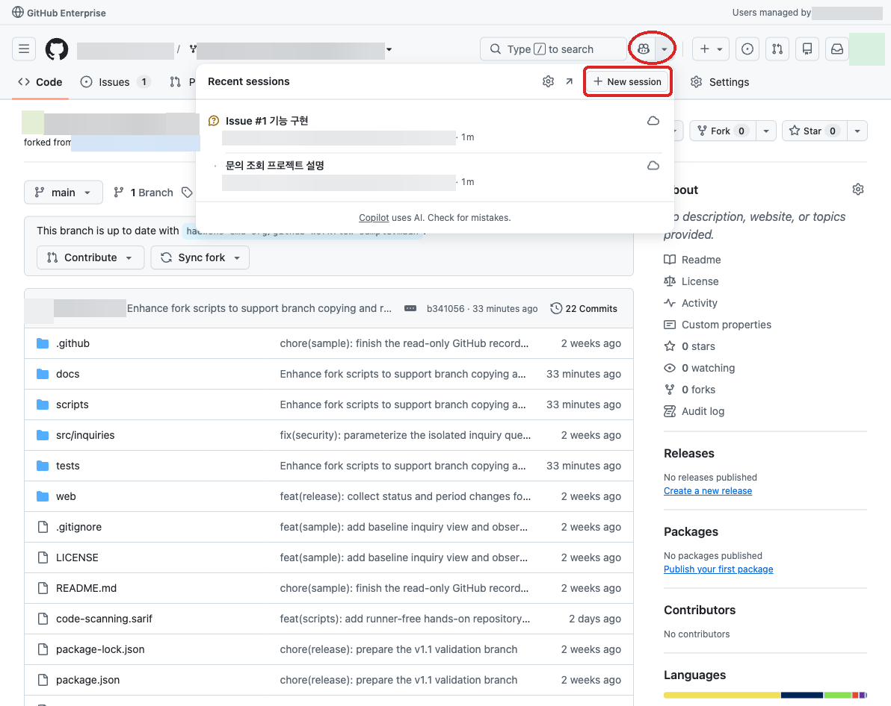
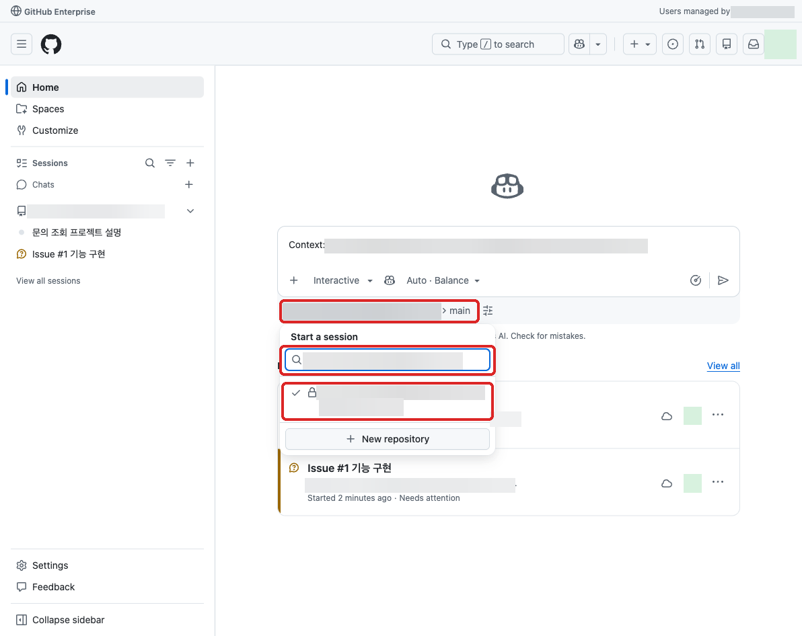

# 웹 기반 GHEC Copilot 핸즈온

## 실습 목표와 범위

GitHub Enterprise Cloud(GHEC)의 Enterprise Managed Users(EMU) 조직 저장소를 연결한 Copilot 세션에서 자연어로 요청하고, 기능 요청·구현 결과·PR·보안 경고를 확인합니다.
대상은 PM과 업무 담당자이며, 직접 명령을 입력하기보다 요청의 완료 조건과 결과의 근거를 확인합니다.

- 기본 실습은 github.com에서 진행하며, VS Code, 로컬 clone·터미널·테스트와 Codespaces는 사용하지 않습니다.
- 04번의 SARIF 등록 명령은 관심 있는 실습자만 선택해 실행하는 추가 실습이며, 기본 실습의 필수 조건이 아닙니다.
- 실습에 사용하는 '고객 문의 포털'은 이 저장소에 포함된 보안 이슈가 있는 샘플 코드이며, 이 샘플 코드를 기반으로 프로젝트 이해, 기능 개선과 테스트, PR 검수, 보안 이슈 분석을 진행합니다.

루트 README의 “코드를 바꾸지 않는 열람용 샘플”은 공개 원본의 기록 열람 범위를 설명합니다.
이 핸즈온에서는 기업 내부 기준 저장소를 포크한 **본인 실습 저장소**에서만 승인된 변경을 수행하며, 기준 저장소나 공개 원본을 변경하지 않습니다.

## 실습 환경

GitHub 우측 상단의 Copilot 아이콘을 클릭한 뒤 [New Session](https://github.com/copilot) 메뉴를 클릭합니다.
본인의 실습 저장소를 연결하고 자연어로 요청하며 진행합니다.

* Actions runner는 사용하지 않으며 workflow 실행·재실행, CodeQL 재분석 등 runner를 사용하는 작업은 요청하지 않습니다.
* 코드 구현·테스트는 조직이 승인한 `Cloud` 환경에서만 요청합니다. Cloud 사용 권한·비용을 확인하고 `Actions` 환경은 선택하지 않습니다.
* 기본 실습에서는 Issue를 Copilot에게 할당하지 않고 [New Session](https://github.com/copilot)에서 `Cloud`를 선택해 요청합니다. Issue 할당은 작업을 바로 시작할 수 있으므로 Runner 사용·비용이 별도 승인된 02번 선택 실습으로만 진행합니다.
* 자동 리뷰·자동화·병합·배포는 진행하지 않습니다. Cloud를 사용할 수 없으면 질문·초안·기존 자료 검수까지만 진행합니다.

### 화면과 프롬프트 읽는 법

이 가이드의 스크린샷은 2026-11-13에 EMU 계정으로 직접 확인한 GitHub 영문 화면입니다.
화면의 `haewons-emu-org`와 `github-workflow-haewonshin_azkr`는 테스트 예시입니다.
스크린샷의 이름·계정 ID·프로필 이미지와 세션 ID는 블러 처리했습니다. 저장소 이름·링크에 포함된 계정 식별 정보도 가렸습니다.
빨간 네모·동그라미는 각 단계에서 클릭하거나 확인할 영역입니다. 설정 화면의 표시는 상태 확인용이며 설정 변경을 지시하지 않습니다.
본인은 제공받은 조직과 **본인 포크**를 선택하고, 프롬프트의 `조직/저장소`·`Issue 링크`·`PR 링크`도 실제 값으로 바꿉니다.
스크린샷의 Issue·PR 번호나 경고 상태를 본인의 결과로 복사하지 않습니다.

Copilot 아이콘 옆 화살표에서 `New session`을 엽니다. 저장소가 자동으로 연결됐더라도 이름과 브랜치를 다시 확인합니다.
`Chat (Personal)` 상태에서 조직 저장소가 검색되지 않으면 저장소 선택 창의
`Chat` 옆 범위 선택에서 본인 조직으로 바꾼 뒤 검색합니다.
조직을 선택해도 보이지 않으면 준비 담당자에게 Seat·Cloud 저장소 접근 허용·포크 권한 확인을 요청합니다.
실습자가 조직 정책이나 비용 설정을 직접 바꾸지 않습니다.

저장소 선택은 문맥 연결이고 실행 환경 선택은 별도입니다. 입력창 아래 환경 아이콘의
`Environment` 메뉴에서 `Cloud`를 확인합니다. 화면에 Cloud가 보이는 것만으로 비용·정책 승인이 완료된 것은 아닙니다.
설명·초안만 요청할 때도 자동 구현이나 게시를 원하지 않는다는 지침을 유지합니다.

## 실습 순서

00번에서 사전에 제공된 기업 내부 기준 저장소를 포크하고 본인 실습 저장소의 준비 상태를 확인합니다.

기준 저장소 이름은 `github-workflow-sample`, 실습자 포크 이름은 `github-workflow-<USER_ID>`로 지정합니다.
`<USER_ID>`는 본인의 GitHub 사용자 ID로 바꿉니다.

저장소 준비 후 01~04 단계별 권한·실행 환경을 확인하고 실습을 진행합니다.
세션 B에서 생성한 PR을 세션 C에서 검수하므로 별도 검수용 PR은 준비하지 않습니다.

| 실습 문서 | 실습 내용 | 시간 |
|-----------|----------------------|------|
| [00. 실습을 위한 저장소 사전 준비](00-preparation.md) | 내부 기준 저장소 포크, 실습 환경 점검 | 15분 |
| [01. 프로젝트 이해 (세션 A)](01-project-understanding.md) | 저장소에서 Copilot에게 자연어로 질의하며 코드 이해 | 10분 |
| [02. 새 요구사항 요청 (세션 B)](02-feature-request.md) | Issue 작성, 승인된 Cloud 환경에서 구현 요청 | 10분 |
| [03. PR 검수와 보완 (세션 C)](03-pr-review.md) | PR 질문·댓글 게시·같은 PR 보완 요청 | 10분 |
| [04. 보안 경고 해석과 조치 (세션 D)](04-security.md) | 보안 경고 해석 및 조사 Issue 등 조건부 수정 요청 | 15분 |

표의 시간은 입력·검토 기준입니다. Cloud 대기, 의존성 설치와 준비 담당자의 권한 확인 시간은 별도로 확보합니다.

2026-11-13 실제 테스트 범위와 남은 확인

기업 내부 기준 저장소 `haewons-emu-org/github-workflow-sample`에서
`haewons-emu-org/github-workflow-haewonshin_azkr`를 포크해 테스트했습니다.
테스트 계정은 포크 관리자 권한이 있으므로, 일반 실습자의 계정·권한으로도 사전 점검이 필요합니다.
로컬 문서·이미지 변경은 원격 저장소에 게시하지 않았습니다.

| 단계 | 직접 확인한 결과 |
|---|---|
| 00 | 기업 내부 포크 생성. 새 포크의 Actions 활성화·Issues 비활성화·Code Security 미적용을 발견했고 준비 담당자 역할로 해당 포크의 Actions 차단·Issues 활성화만 적용했습니다. 보안 기능은 켜지 않았습니다. |
| 01 | 본인 포크를 연결한 Cloud 세션에서 프로젝트 설명·추가 질문과 코드 근거를 확인했습니다. Personal 범위에서 검색되지 않던 저장소는 조직 범위 선택 후 표시됐습니다. |
| 02 | [기능 Issue #1](https://github.com/haewons-emu-org/github-workflow-haewonshin_azkr/issues/1)과 [Draft PR #3](https://github.com/haewons-emu-org/github-workflow-haewonshin_azkr/pull/3)을 생성했습니다. Cloud의 설정 API 403은 관리자 수동 확인 증빙을 전달해 처리했으며 App 권한은 확대하지 않았습니다. |
| 03 | 같은 PR의 여섯 완료 조건·diff·커밋·Checks 0건을 대조했습니다. 기능·테스트 누락이 없어 보완 댓글 게시와 추가 수정·push는 하지 않았습니다. 댓글 입력 위치만 확인했습니다. |
| 04 | 기준 저장소의 기존 경고 두 건과 SARIF·현재 코드의 차이를 확인하고 [조사 Issue #2](https://github.com/haewons-emu-org/github-workflow-haewonshin_azkr/issues/2)에 근거·담당자·검증 대기를 남겼습니다. |

기능 PR의 검증 대상 커밋은 `44c051fc1a483454ef9fb9148286d2599cf69789`입니다.
구현 Cloud 세션의 실제 도구 출력에서 `npm run test:ui` **8개 통과**,
`npm run test:unit` **45개 통과·14개 미실행**을 확인했습니다.
14개는 PowerShell 7.4+ 미설치로 건너뛴 준비 스크립트 검사이며, Windows 검증 완료로 해석하지 않습니다.
의존성 누락으로 UI 검사가 처음 실패한 뒤 잠금 파일 기준 설치·재실행을 거쳤습니다.

기준 저장소와 포크의 `main`은 유지했고, 포크의 Actions 실행은 0건입니다.
플랫폼이 PR 생성 시 자동 표시한 Copilot 담당자는 해제했으며 자동 리뷰·Agent Merge·병합·배포를 실행하지 않았습니다.
본인 포크의 Code scanning 조회·선택 SARIF 업로드, 새 CodeQL 분석, Runner 할당형 선택 실습과
누락이 있을 때의 댓글 게시·동일 PR 보완은 이번 테스트에서 실행하지 않았습니다.

## 참고

### Copilot과 실행 환경

* [GitHub 웹 Copilot의 대화·에이전트·실행 환경](https://docs.github.com/en/copilot/concepts/copilot-surfaces/copilot-on-github)
* [GitHub 웹에서 Copilot 세션 시작·환경 선택·Issue 할당](https://docs.github.com/en/copilot/how-tos/use-copilot-agents/cloud-agent/use-cloud-agent-on-github)
* [Cloud 샌드박스와 Actions 환경 구분](https://docs.github.com/en/copilot/concepts/security-governance-and-network-settings/about-cloud-sandboxes)
* [조직·기업의 Cloud 사용 정책과 예산 관리](https://docs.github.com/en/copilot/how-tos/cloud-and-local-sandboxes/enabling-or-disabling-cloud-sandboxes-for-your-organization)
* [Cloud 샌드박스 사용량과 과금 기준](https://docs.github.com/en/billing/concepts/product-billing/cloud-and-local-sandboxes)

### 저장소 준비와 실행 차단

* [EMU·private·internal 저장소의 포크 정책과 권한](https://docs.github.com/en/enterprise-cloud@latest/pull-requests/reference/forks)
* [저장소 Actions 설정과 비활성화](https://docs.github.com/en/repositories/managing-your-repositorys-settings-and-features/enabling-features-for-your-repository/managing-github-actions-settings-for-a-repository)

### 보안 경고와 SARIF

* [Code scanning 경고 열람 권한과 결과 확인](https://docs.github.com/en/code-security/how-tos/manage-security-alerts/manage-code-scanning-alerts/assess-alerts)
* [기존 SARIF 업로드 요구사항과 등록 방법](https://docs.github.com/en/code-security/how-tos/find-and-fix-code-vulnerabilities/integrate-with-existing-tools/upload-sarif-file)
* [SARIF 등록·처리 상태 확인 API](https://docs.github.com/en/rest/code-scanning/code-scanning)
