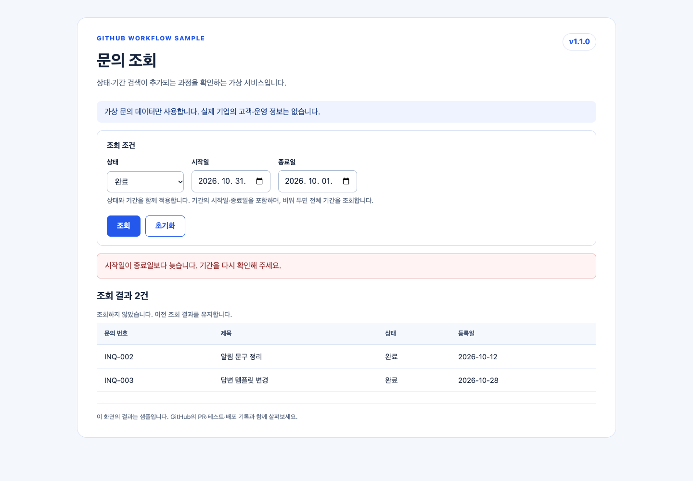

# GitHub 기록 열람 가이드

코드를 개발하지 않는 업무 담당자가 같은 요청의 변경·검증·배포 결과를 대조하는 안내입니다.
**실습 과제는 없습니다.** GitHub 기록을 읽고, 가상 문의 화면의 결과를 살펴보면 됩니다.

## 열람 범위와 권한

소스·브랜치·Issue·PR·공개 Release는 저장소에서 확인합니다.
Actions 보고서 다운로드는 로그인이 필요할 수 있고, 보안 원본·설정은 계정 권한에 따라 제한됩니다.
설정 메뉴가 열리지 않아도 [공개 보안 리포트](security-report.md)와 설정 파일을 읽을 수 있습니다.

## 1. 요구사항과 남은 작업

[요구사항 Issue #2](https://github.com/hijigoo/github-workflow-sample/issues/2)를 엽니다.
요청은 상태·기간 조건의 동시 적용, 잘못된 기간의 안내·조회 차단, 빈 결과 안내입니다.

댓글은 **상태 PR 반영 → 기간 PR → 미완성 QA 후보 취소 → main 반영 → 운영 배포** 순서로 이어집니다.
커밋 수를 진척률로 환산하지 않고 완료 조건과 연결 기록을 대조합니다.
Issue Closed와 PR Merged만으로 배포 완료를 판단하지 않는 예도 남겼습니다.

## 2. 기능 추가 노트와 리뷰

[상태 검색 PR #3](https://github.com/hijigoo/github-workflow-sample/pull/3)과 [기간 검색 PR #4](https://github.com/hijigoo/github-workflow-sample/pull/4)를 엽니다.

| PR 영역 | 읽을 것 |
|---|---|
| Conversation | 변경 내용·관련 요청·검증 결과·질문과 답변 |
| Commits | 테스트 먼저 기록한 변경과 실제 보완 변경 |
| Files changed | 상태·기간 처리와 안내가 바뀐 위치 |
| Checks | 해당 커밋의 Build·Test·분석 결과 |

[PM 질문과 수행사 답변](https://github.com/hijigoo/github-workflow-sample/pull/4#issuecomment-6556348093)은 가상 역할 예입니다.
실제 댓글 작성 계정을 다른 직원이나 업체로 위장하지 않았습니다.

## 3. 배포 준비 노트

[배포 준비 PR #5](https://github.com/hijigoo/github-workflow-sample/pull/5)는 `dev → release/v1.1`입니다.
본문의 포함 목록, QA·주의사항, DB·환경변수 변경 여부를 확인합니다.

작성 시 대기였던 기간 입력 확인은 [후속 QA 댓글](https://github.com/hijigoo/github-workflow-sample/pull/5#issuecomment-6556427564)에 이어집니다.
[최초 후보](https://github.com/hijigoo/github-workflow-sample/actions/runs/41294211185)는 Build가 성공했어도 기간 변경이 아직 없어서 배포 승인 없이 취소했습니다.

## 4. 릴리스 반영 노트와 최종 공지

[릴리스 반영 PR #6](https://github.com/hijigoo/github-workflow-sample/pull/6)은 `release/v1.1 → main`입니다.
QA·업무 확인·운영 승인 대기·알려진 사항·롤백 기준을 읽습니다.

운영 확인은 [후속 댓글](https://github.com/hijigoo/github-workflow-sample/pull/6#issuecomment-6556625148)에 연결했습니다.
[최종 Release v1.1.0](https://github.com/hijigoo/github-workflow-sample/releases/tag/v1.1.0)는 main의 태그에 연결한 별도 공지입니다.
변경 목록·주의사항·Changelog·배포 파일을 확인합니다.

[역병합 PR #7](https://github.com/hijigoo/github-workflow-sample/pull/7)은 검증한 버전 정보를 dev에도 이어주는 기록입니다.
기능·release 브랜치가 남아 있어 병합 전후의 내용도 비교할 수 있습니다.

## 5. 실제 문의 화면의 결과

[운영 샘플](https://hijigoo.github.io/github-workflow-sample/)과 [QA 샘플](https://hijigoo.github.io/github-workflow-sample/qa/)은 같은 v1.1.0 파일을 사용합니다.
화면 입력은 가상 데이터 필터링일 뿐 저장소·원본 데이터를 수정하지 않습니다.

| 살펴볼 조건 | 게시 화면의 결과 |
|---|---|
| 전체 조회 | 여섯 건 |
| 완료 상태 | 세 건 |
| 완료 + 2026-10-01 ~ 2026-10-31 | INQ-002·INQ-003 두 건 |
| 시작일이 종료일보다 늦은 기간 | 안내, 조회 차단, 직전 결과 유지 |
| 완료 + 2026-08-01 ~ 2026-08-31 | 빈 결과 안내 |
| 초기화 | 조건 초기화, 전체 여섯 건 |

## 6. Actions와 세 종류의 승인

[최종 QA 실행](https://github.com/hijigoo/github-workflow-sample/actions/runs/41295071790)은 Build·Test 후 환경 승인과 QA 배포로 이어집니다.
[운영 승격 실행](https://github.com/hijigoo/github-workflow-sample/actions/runs/41295786524)은 해당 QA 파일을 다운로드하여 해시를 확인하고 **재빌드 없이** 게시합니다.

PR 리뷰 승인은 변경 검토, 외부 작성자 workflow 승인은 실행 허용, 환경 승인은 배포 허용입니다.
이 저장소에는 세 종류의 실제 샘플 승인 기록이 있습니다. 기업의 운영 승인 체계를 구현한 것은 아닙니다.

운영·QA 증빙의 `source_commit`, `sha256`, `release_run_id`를 Release 파일과 대조할 수 있습니다.
최종 파일은 코드 분석 격리 예시·개발 의존성·키·환경 파일을 포함하지 않습니다.

## 화면이 열리지 않을 때

보고서 보존 기한과 로그인·계정 권한을 확인합니다.
Code scanning·Dependabot·Secret scanning·설정의 권한은 모두 같지 않습니다.
보고서 원본 접근이 안 되면 공개 Release 증빙과 [민감 값 없는 보안 리포트](security-report.md)를 사용합니다.

이 안내와 가상 역할 문안은 Copilot을 활용해 작성했습니다. 링크의 실행·댓글·승인 기록은 실제 GitHub 기록입니다.
